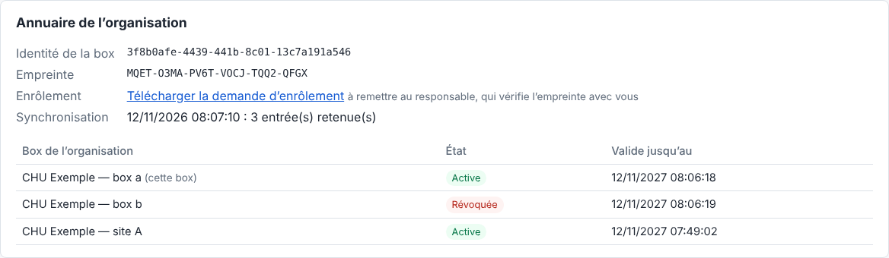

# Annuaire signé

> Objectif (pilote, priorité 1 du [plan](plan-de-realisation.md)) : savoir **qui est qui** entre les box d'une organisation. Chaque box est enrôlée par le responsable de l'organisation, qui signe son entrée ; les box vérifient ces signatures avant d'échanger et refusent une box révoquée. Conforme au § 9 de la [spécification IU-T](specification-protocole.md), et utilisable dès maintenant avec le transport SimpleX.
> Statut : **toutes les étapes faites** (A, B, C1, C2a, C2b) : socle cryptographique, outil du responsable, service d'annuaire, intégration dans la box, appairage par l'annuaire, annonces et accusés signés. Clés privées chiffrées par phrase de passe (§ 9) ; le support matériel attend la prise en charge de ML-DSA par les TPM et HSM. Les entrées publient aussi les clés de chiffrement des box : voir le [chiffrement applicatif](chiffrement-applicatif.md).

## 1. Principes

```
           Responsable de l'organisation (clé hors ligne)
                 │ signe les entrées (enrôlement, révocation)
                 ▼
  Box A ───lit───► Annuaire (publie les entrées signées) ◄───lit─── Box B
    │                                                               │
    └── vérifie la signature avec la clé du responsable, épinglée ──┘
        à l'installation après vérification hors bande de son empreinte
```

- **L'annuaire n'est pas de confiance.** Il ne fait que publier des entrées signées par le responsable. Un annuaire compromis ne peut ni créer une box, ni changer ses clés. Il ne peut que retenir des entrées (déni de service), et il ne peut pas faire revenir une entrée remplacée (§ 3).
- **La clé du responsable** est la racine de confiance. Elle reste hors ligne, chez le responsable. Chaque box l'**épingle** à l'installation, après avoir vérifié son empreinte courte par un autre canal (téléphone, papier, QR code).
- **Chaque box a sa propre identité** : une paire de clés de signature générée dans la box, et qui ne la quitte jamais (TPM ou élément sécurisé pour le pilote).
- **Cryptographie** : uniquement des primitives standard du JDK 25. La suite `IU1` signe en double avec Ed25519 (RFC 8032) et ML-DSA-65 (FIPS 204, résistant au calcul quantique), et les deux signatures doivent être valides.

## 2. Formats

### 2.1 Document signé

Toute pièce signée (demande d'enrôlement, entrée de box) a la même enveloppe :

```json
{
  "payload": "{\"suite\":\"IU1\",\"boxId\":\"…\", …}",
  "signatures": { "suite": "IU1", "ed25519": "<base64>", "mlDsa65": "<base64>" }
}
```

La signature porte sur les **octets UTF-8 exacts** du texte `payload`. Celui-ci n'est relu qu'après vérification. Ce choix évite toute canonicalisation du JSON, source classique d'erreurs.

### 2.2 Entrée de box

```json
{
  "suite": "IU1",
  "organization": "chu-exemple",
  "boxId": "3f6c…",
  "displayName": "CHU Exemple — imagerie",
  "signingKeys": { "ed25519": "<X.509 base64>", "mlDsa65": "<X.509 base64>" },
  "encryptionKeys": { "x25519": "<X.509 base64>", "mlKem768": "<X.509 base64>" },
  "transport": { "simplex": "<adresse de contact SimpleX>" },
  "serial": 1,
  "validFrom": "2026-11-12T00:00:00Z",
  "validUntil": "2027-11-12T00:00:00Z",
  "revoked": false, "revokedAt": null, "revocationReason": null
}
```

- `serial` augmente à chaque nouvelle émission pour la même box (renouvellement, changement d'adresse, révocation) : seule l'entrée de numéro le plus haut compte.
- La **révocation** est une entrée signée de numéro supérieur, avec `revoked: true`.
- `encryptionKeys` porte les clés de chiffrement de la box (X25519 et ML-KEM-768). Les paquets qui lui sont destinés sont chiffrés pour elles ([chiffrement applicatif](chiffrement-applicatif.md)). Le champ est absent des entrées antérieures, qui sont à réémettre.

### 2.3 Demande d'enrôlement

La box produit une demande signée **par ses propres clés** : identifiant, nom proposé, clés publiques de signature et de chiffrement, adresse de transport, date. Cette signature prouve qu'elle détient les clés privées correspondantes. Le responsable vérifie cette preuve, puis confirme hors bande l'empreinte de la box avec son installateur avant de signer l'entrée.

### 2.4 Empreinte courte

L'empreinte d'une clé hybride est le SHA-256 de `IU1`, puis des deux clés publiques. Pour la lire au téléphone, ses 120 premiers bits sont écrits en base 32 par groupes de quatre, par exemple `K7QF-2MZD-XA4N-…` (6 groupes).

## 3. Règles de vérification (côté box)

Une entrée n'est retenue que si :

1. ses deux signatures sont valides avec la clé épinglée du responsable ;
2. sa suite est `IU1` et son organisation est celle de la box ;
3. son numéro n'est pas inférieur au plus haut déjà vu pour cette box. Sinon, c'est un **retour en arrière**, qui est refusé et signalé : un annuaire compromis pourrait sinon resservir l'entrée d'avant une révocation ;
4. et, pour l'échanger avec une box, la date courante est dans `[validFrom, validUntil)` et l'entrée n'est pas révoquée.

Le résultat est l'un des états suivants : `ACTIVE`, `REVOKED`, `EXPIRED` ou `NOT_YET_VALID`. Une signature invalide, une autre organisation ou un retour en arrière sont des **erreurs de sécurité**, pas des états.

## 4. Outil du responsable (étape A)

L'outil est en ligne de commande, et le responsable l'exécute sur un poste qui garde sa clé hors ligne :

| Commande | Effet |
|---|---|
| `organisation-creer --organisation <id> --cles <fichier>` | Génère la clé du responsable (fichier privé, droits 600) et sa clé publique `<fichier>.pub.json` ; affiche l'empreinte courte |
| `empreinte --cle-publique <fichier>` | Affiche l'empreinte courte d'une clé publique d'organisation |
| `box-demande --cles <fichier> --box-id <uuid> --nom <nom> [--simplex <adresse>] --sortie <fichier>` | Côté box, en attendant l'étape C : génère l'identité de la box si besoin (clés de signature, et clés de chiffrement dans `<fichier>.chiffrement`) et produit une demande signée |
| `enroler --cles <clé organisation> --demande <fichier> [--validite-jours 365] [--serie 1] --sortie <fichier>` | Vérifie la preuve de possession, affiche l'empreinte de la box à confirmer hors bande, puis signe l'entrée |
| `revoquer --cles <clé organisation> --entree <fichier> --motif <texte> --sortie <fichier>` | Émet l'entrée révoquée (numéro + 1) |
| `verifier --cle-publique <fichier> --entree <fichier>` | Vérifie une entrée et affiche son état |
| `proteger --cles <fichier> [--box]` | Chiffre par phrase de passe une clé existante en clair (§ 9) |

Lancement, en attendant un paquet dédié (étape B) :

```bash
cd backend && ./mvnw -q -pl directory package dependency:build-classpath -Dmdep.outputFile=cp.txt
LANG=C.UTF-8 java -cp directory/target/classes:$(cat cp.txt) com.imagunity.directory.DirectoryAdmin <commande> …
```

Le terminal doit être en UTF-8 (`LANG=C.UTF-8` ou équivalent). Sinon, la JVM décode mal les arguments accentués, par exemple un nom de box avec « — ».

Exemple : l'organisation reçoit l'empreinte `TVF3-WIAA-CQ6V-MZGC-HKTQ-5WEH`, et la box `FI55-3QYO-MVFX-OFXI-CNEK-NQ77`. Après révocation, `verifier` affiche `REVOKED` et sort avec le code 1. Une entrée pèse environ 7,5 Ko, à cause de la clé et de la signature ML-DSA-65.

Les clés privées sont stockées en PKCS#8 dans un fichier JSON, en droits 600, **chiffrées par phrase de passe** (§ 9).

## 5. Service d'annuaire (étape B)

Module `directory-server` : une application Spring Boot autonome, sur **PostgreSQL** (Flyway), servie sur le port 8090.

| Requête | Accès | Réponse |
|---|---|---|
| `GET /directory/v1/organization` | libre | organisation, clé publique et empreinte courte du responsable (pour information : chaque box épingle sa copie, vérifiée hors bande) |
| `GET /directory/v1/entries` | libre | entrée courante (numéro le plus haut) de chaque box |
| `GET /directory/v1/entries/{boxId}` | libre | entrée courante d'une box ; 404 si inconnue |
| `GET /directory/v1/entries/{boxId}/history` | libre | toutes ses entrées, par numéro croissant |
| `POST /directory/v1/entries` | compte du responsable (HTTP Basic) | 201 publiée, 200 déjà publiée à l'identique, 409 retour en arrière ou autre entrée sous le même numéro, 422 entrée invalide (signature, organisation, format) |

- **Le service revérifie** chaque dépôt avec la clé publique de l'organisation (`IMAGUNITY_DIRECTORY_ORGANIZATION_KEY`). C'est une défense en profondeur : les box revérifient tout, le service n'étant pas de confiance.
- **Historique** : chaque entrée publiée est gardée, une ligne par box et par numéro.
- **Lecture libre** : les entrées sont signées et ne contiennent que des clés publiques, des noms et des adresses de transport. Les réserver aux box enrôlées est possible plus tard (signature des requêtes, § 6.4 de la spécification).
- **Compte de dépôt** : `IMAGUNITY_DIRECTORY_PUBLISHER_USER` (par défaut `responsable`) et `IMAGUNITY_DIRECTORY_PUBLISHER_PASSWORD`, en clair ou haché `{bcrypt}`. Sans mot de passe, il est généré et journalisé au démarrage.
- **Publication** depuis l'outil du responsable : `publier --annuaire <url> --entree <fichier>`. Le compte passe par `IMAGUNITY_ANNUAIRE_COMPTE=utilisateur:mot-de-passe`, plutôt que par l'option `--compte` qui est visible dans la liste des processus.
- **Compose** : services `directory` et `directory-db` sous le profil `annuaire` (`docker compose --profile annuaire up -d`), avec la clé publique de l'organisation dans `deploy/annuaire/organisation.pub.json`.

Vérifié en réel sur PostgreSQL 17 :
- migration appliquée, deux box publiées, publication en double « déjà publiée » ;
- révocation publiée, puis retour en arrière refusé (409) et dépôt sans compte refusé (401) ;
- entrée relue depuis l'annuaire, puis revérifiée `ACTIVE` avec la clé épinglée ;
- historique complet en base.

Le service fonctionne aussi dans le Compose. Les tests automatisés tournent sur H2 en mode PostgreSQL.

## 6. Intégration dans la box (étape C1)

Activée par `IMAGUNITY_DIRECTORY_ENABLED=true`. Sans elle, la box fonctionne comme avant : tout partenaire appairé est accepté.

| Réglage | Rôle |
|---|---|
| `IMAGUNITY_DIRECTORY_URL` | service d'annuaire de l'organisation |
| `IMAGUNITY_DIRECTORY_ORGANIZATION_KEY` | clé publique du responsable (`.pub.json`) |
| `IMAGUNITY_DIRECTORY_ORGANIZATION_CODE` | son empreinte courte, **vérifiée hors bande** avec le responsable puis recopiée ici. Si elle ne correspond pas à la clé installée, la box **refuse de démarrer** et affiche l'empreinte de la clé |
| `IMAGUNITY_DIRECTORY_SYNC_INTERVAL` | intervalle de lecture de l'annuaire (5 min par défaut) |

- **Identité de la box** : générée au premier démarrage (`data/identite-box.json`, droits 600, et son identifiant dans `.id`), puis relue.
- **Enrôlement** : la console propose « Télécharger la demande d'enrôlement » (`GET /api/v1/directory/enrollment-request`). La demande est signée par la box. Le responsable l'enrôle avec son outil, vérifie avec l'installateur l'empreinte affichée des deux côtés, puis publie l'entrée.
- **Synchronisation** : au démarrage, puis à intervalle régulier. Chaque entrée est revérifiée avec la clé épinglée ; un retour en arrière est refusé, car les numéros vus sont gardés en base. Les entrées sont gardées en cache, si bien que la box fonctionne même si l'annuaire est injoignable.
- **Liaison des partenaires**, par une poignée de main signée en défi-réponse :

  ```
  A → B : hello {boxId: A, challenge: cA}
  B → A : proof {boxId: B, challenge: cA, signature de B sur « IU1-hello, cA, B, A »}
  ```

  A vérifie que `cA` est le défi qu'il a envoyé à ce contact, que B est actif dans l'annuaire et que la signature est valide avec la clé de B publiée dans l'annuaire. Le contact SimpleX est alors **lié** à la box B. La preuve couvre le défi frais de A et les deux identifiants : une autre box ne peut pas la rejouer. La poignée de main est relancée après chaque synchronisation pour les partenaires pas encore liés.
- **Contrôle d'accès** : on n'envoie qu'à un partenaire lié dont la box est active (sinon le transfert passe en échec avec le motif), et l'on ne reçoit que d'un tel partenaire (fichiers et annonces ignorés et journalisés). Les motifs de refus :
  - « Partenaire « box-b » pas encore vérifié par l'annuaire » ;
  - « Box du partenaire « box-b » révoquée dans l'annuaire » ;
  - « Entrée d'annuaire … expirée » ;
  - « Box … absente de l'annuaire ».
- **Console** : carte « Annuaire de l'organisation » (identité, empreinte, demande d'enrôlement, dernière synchronisation, box connues et leur état), et état vérifié ou révoqué de chaque partenaire.



**Compose** : `compose.annuaire.yml` active l'annuaire dans les deux box.

```bash
export IMAGUNITY_DIRECTORY_ORGANIZATION_CODE=<empreinte vérifiée hors bande>
docker compose -f docker-compose.yml -f compose.annuaire.yml --profile annuaire up -d
```

**Vérifié en réel**, avec deux box, les relais SimpleX, l'annuaire et PostgreSQL :
1. Avant l'enrôlement, le transfert est refusé : « pas encore vérifié par l'annuaire ».
2. Les box sont enrôlées à partir de leur demande téléchargée sur la console. Les empreintes affichées par l'outil du responsable sont exactement celles des consoles des box.
3. Environ 10 s après la publication, chaque box a lié son partenaire.
4. Le transfert réussit : 100 instances identiques sur 100, accusé en 12,6 s.
5. Après la révocation de B, la box A la voit à la synchronisation suivante, et le transfert est refusé : « révoquée dans l'annuaire ».

## 7. Appairage par l'annuaire (étape C2a)

Plus d'invitation à transmettre à la main entre deux box de l'organisation :

```
Box A (console)                         Annuaire                      Box B
  « Appairer box-b » ──connexion à l'adresse publiée de B───────────────► demande de contact
                                                                          acceptée → partenaire provisoire « attente-3 »
  ◄────────────── poignée de main signée (défi-réponse, § 6) ──────────────►
  partenaire « box-b » lié à la box B                                    « attente-3 » lié à A, renommé « box-a »
```

- **Adresse publiée** : la demande d'enrôlement contient l'adresse de contact SimpleX durable de la box, créée au premier besoin. Le responsable la signe avec le reste de l'entrée, si bien qu'elle ne peut pas être substituée par l'annuaire.
- **Côté demandeur (A)** : la console liste les box de l'organisation. Pour une box active et joignable, l'opérateur choisit un nom local (proposé à partir du nom d'annuaire) et clique « Appairer » (`POST /api/v1/directory/boxes/{boxId}/pair`). Sont refusés : cette box elle-même, une box inactive, une box sans adresse, une box déjà appairée.
- **Côté appelé (B)** :
  - la demande de contact est acceptée, et la connexion enregistrée comme partenaire **provisoire** `attente-<n>`, autorisé à rien ;
  - une fois la poignée de main vérifiée, il prend le nom de la box dans l'annuaire (`box-a` ; `CHU Exemple — box a` donnerait `chu-exemple-box-a`), avec un suffixe si le nom est pris ;
  - un contact en double vers une box déjà liée est oublié ;
  - un provisoire jamais vérifié est oublié au bout d'une heure.
- **Nommage** : enrôler les box sous un nom court (par exemple `box-a`) donne les mêmes noms des deux côtés, ceux qu'utilisent les routes DICOM (`destination`).
- **Sans annuaire**, rien ne change : les demandes de contact sont ignorées, l'appairage se fait par invitation.

**Vérifié en réel** sur une pile neuve (aucun appairage préalable) :
1. Les box sont enrôlées avec leur adresse.
2. Un clic dans la console de A suffit : les deux côtés sont **liés et vérifiés en 3 s**, et B a nommé son partenaire `box-a` d'après l'annuaire.
3. Le transfert réussit : 100 instances identiques sur 100, accusé en 12,5 s.
4. Une seconde connexion à l'adresse de B n'aboutit pas : le client SimpleX la reconnaît comme un contact existant.

## 8. Annonces et accusés signés (étape C2b)

Avec l'annuaire, les messages de signalisation passent à l'enveloppe **version 2** :

```json
{"type": "imagunity.transfer.announce", "version": 2, "boxId": "<box émettrice>",
 "payload": "{…annonce ou accusé, texte JSON exact…}",
 "signature": {"suite": "IU1", "ed25519": "…", "mlDsa65": "…"}}
```

- La box émettrice signe « `IU1-msg`, type, `payload` » avec ses clés.
- Le destinataire n'accepte le message que si `boxId` est la box à laquelle ce contact est lié, et si la signature est valide avec la clé de cette box **publiée dans l'annuaire**. Un message non signé (version 1), signé par une autre box ou falsifié est refusé et journalisé.
- Le résultat est la **non-répudiation** : l'émetteur ne peut pas nier avoir annoncé un examen, ni le destinataire l'avoir accusé (§ 8.4 de la spécification).
- La forme gardée en base reste non signée (version 1). Sans annuaire, rien ne change.
- La signature ajoute environ 4,5 Ko par message, à cause de ML-DSA-65. C'est sans effet sur les annonces courantes, mais une annonce de plusieurs milliers de paquets dépasserait la taille d'un message SimpleX (environ 15 Ko) : il faudra alors découper l'annonce.

**Vérifié en réel** :
- transfert entre box appairées par l'annuaire réussi : 100 instances identiques sur 100, accusé en 11,8 s ;
- dans la base du client SimpleX de B, l'annonce et l'accusé échangés sont en version 2, signés respectivement par A et par B ;
- une annonce non signée, envoyée par le canal de A hors de la box A, est refusée par B (« message non signé »), et aucun transfert n'est créé.

## 9. Protection des clés privées

Les clés privées (responsable et box) sont **chiffrées par phrase de passe**, avec uniquement des primitives standard du JDK :

| Élément | Choix |
|---|---|
| Dérivation de la clé de chiffrement | PBKDF2-HMAC-SHA256, 600 000 itérations, sel aléatoire de 16 octets |
| Chiffrement | AES-256-GCM, nonce aléatoire de 12 octets |
| Données associées | « `IU1-cle` » et l'empreinte de la clé publique : un chiffré transplanté sous une autre clé publique ne s'ouvre pas |
| Phrase de passe | 12 caractères au moins |

Le fichier garde la clé publique en clair, avec la protection (`protection` : algorithmes, paramètres, sel, nonce, chiffré). Une phrase de passe incorrecte ou un fichier altéré sont refusés : « Phrase de passe incorrecte, ou fichier de clé altéré ». Les fichiers en clair antérieurs restent lisibles et peuvent être chiffrés sur place, en remplaçant le fichier d'un coup et en gardant les droits 600.

**Outil du responsable** :
- la phrase de passe vient de `IMAGUNITY_PHRASE_ORGANISATION` (clé du responsable) ou de `IMAGUNITY_PHRASE_BOX` (clé de box créée par l'outil) ; sinon elle est saisie au terminal, deux fois à la création ;
- `--sans-phrase` crée une clé en clair, sur choix explicite et avec un avertissement ;
- `proteger --cles <fichier> [--box]` chiffre une clé existante ;
- utiliser une clé en clair affiche un avertissement.

**Box** :
- la phrase de passe vient de `IMAGUNITY_DIRECTORY_IDENTITY_PASSPHRASE_FILE`, de préférence un **secret Docker** monté hors du volume de données, ou de `..._PASSPHRASE` ;
- l'identité est créée chiffrée ;
- une identité existante en clair est **chiffrée sur place** au démarrage suivant, avec le même identifiant de box ;
- une identité protégée sans phrase, ou avec une mauvaise phrase, empêche la box de démarrer, avec un message explicite ;
- sans phrase de passe, rien ne change, mais un avertissement est journalisé.

Dans le Compose, `compose.annuaire.yml` passe les phrases en secrets `phrase-box-a` et `phrase-box-b` (fichiers `annuaire/phrase-box-x.txt`, non versionnés).

**Ce que cela protège, et ce que cela ne protège pas.** La phrase de passe protège la clé sur les copies du disque : sauvegardes, volume extrait, disque remplacé. Elle ne protège pas d'un attaquant qui contrôle la box en fonctionnement, car la clé est alors en mémoire. Elle ne protège pas non plus si la phrase est stockée à côté de la clé, d'où le secret monté à part.

**Support matériel.** Les clés sont hybrides (Ed25519 et ML-DSA-65). Or les TPM et les HSM courants ne savent pas encore conserver de clé ML-DSA via PKCS#11. Le passage au matériel attend leur prise en charge ; l'interface `KeyFiles` est le point de remplacement.

**Vérifié en réel** :
- les box en service, dont les identités étaient en clair, ont été redémarrées avec leur secret : identité chiffrée sur place, **même identifiant**, partenaires toujours vérifiés, transfert réussi (100/100) ;
- redémarrée sans secret, la box B refuse de démarrer (« Identité de la box protégée par phrase de passe… ») ;
- avec une mauvaise phrase de passe, elle refuse aussi (« Phrase de passe incorrecte… »).

## 10. Reste pour le pilote

- **Support matériel** (TPM pour la box ; carte à puce ou HSM pour le responsable), dès qu'il prendra en charge ML-DSA.
- **Lecture de l'annuaire** réservée aux box enrôlées (requêtes signées), si l'organisation le souhaite.
- **Annonces de très gros examens** : découpage au-delà de la taille d'un message.
- Chiffrement applicatif : fait, voir [chiffrement-applicatif.md](chiffrement-applicatif.md).
