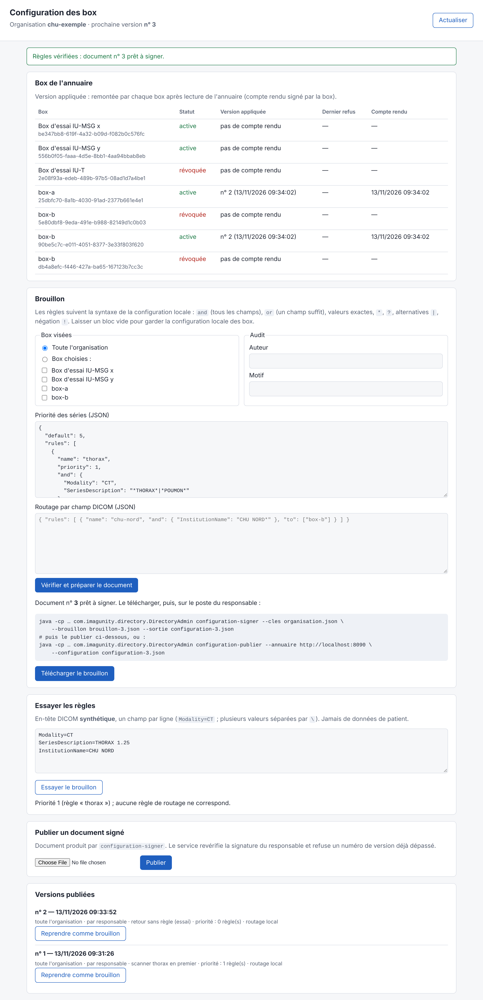

# Configuration centralisée des box (plan)

> Objectif : paramétrer chaque box (règles de priorité, règles de routage, puis d'autres réglages) depuis un serveur central de l'organisation, par une interface d'administration, au lieu de la configuration locale de chaque box.
> Statut : **fait, première version** (novembre 2026), vérifiée sur la pile Docker (§ 9). Décisions : signature par la **clé du responsable** (option C, § 3), périmètre **priorité et routage**, ciblage **toute l'organisation, des box ou des groupes de box** (groupes signés dans l'entrée d'annuaire, § 10), **interface d'administration** simple sur le service d'annuaire. Le reste de ce document garde le plan d'origine ; les questions encore ouvertes sont au § 8.

## 1. Principe

Le **service d'annuaire** est déjà le serveur central de l'organisation, et chaque box le lit régulièrement par connexion sortante ([annuaire signé](annuaire-signe.md)). La configuration y serait publiée de la même façon que les entrées de box :

```
Administrateur ──► interface d'administration ──► service d'annuaire (documents signés)
                                                         ▲
                       box A, box B… (lecture périodique, connexions sortantes seulement)
```

- **Documents de configuration signés**, publiés à côté des entrées d'annuaire : configuration d'une box ou d'un groupe de box.
- **Application par la box** à chaque synchronisation : vérification de la signature, de la cible et du numéro de version, puis application **sans redémarrage**. Document invalide (signature, règle incorrecte, version plus ancienne) : refusé, la configuration précédente reste en vigueur, l'incident est visible dans la console.
- **Rien de nouveau ne s'ouvre** sur les sites : la box tire sa configuration, le serveur ne pousse rien.

## 2. Document de configuration

```json
{
  "suite": "IU1",
  "organization": "chu-exemple",
  "target": { "boxes": ["<boxId>"], "groups": ["imagerie-nord"] },
  "sequence": 12,
  "issuedAt": "2027-01-15T10:00:00Z",
  "priority": {
    "default": 5,
    "rules": [
      { "name": "scanner-thorax", "priority": 1,
        "and": { "Modality": "CT", "SeriesDescription": "*THORAX*|*POUMON*" } },
      { "name": "localisateurs-en-dernier", "priority": 9,
        "or": { "ImageType": "*LOCALIZER*", "SeriesDescription": "*SCOUT*|*TOPO*" } }
    ]
  },
  "routing": { "aet": "IU_AUTO", "rules": [ … ] }
}
```

- Même syntaxe de règles que la configuration locale : `and` (tous les champs), `or` (un champ suffit), valeurs exactes, `*` et `?`, alternatives `|`, négation `!`.
- **Numéro de version croissant** par cible (`sequence`), comme les mises à jour signées : une box refuse un document plus ancien que celui qu'elle applique (pas de retour en arrière imposé par un serveur compromis).
- Signé sur ses octets exacts (suite IU1 : Ed25519 + ML-DSA-65), comme les entrées d'annuaire.
- **Préséance** : configuration centrale si elle existe, sinon configuration locale. Option de verrouillage local (une box de démonstration, par exemple) à décider.

## 3. Qui signe ? (décision à prendre d'abord)

La clé du responsable, qui signe l'annuaire, reste aujourd'hui **hors ligne**. Une interface web qui publie de la configuration suppose de choisir :

| Option | Principe | Avantages | Risques |
|---|---|---|---|
| **A. Clé de configuration déléguée** | Une clé dédiée, sur le serveur, autorisée par un document signé de la clé du responsable ; elle ne peut signer **que** de la configuration | Interface autonome, publication immédiate | Serveur compromis = configuration détournable (routage vers une box de l'organisation, priorités) ; à limiter par des garde-fous (§ 4) |
| **B. Signature dans le navigateur** | Clé de l'administrateur sur son poste (ou carte, clé matérielle) ; le serveur ne fait que stocker | Le serveur ne peut rien signer | Gestion des clés des administrateurs, prise en charge de ML-DSA dans le navigateur |
| **C. Validation en deux temps** | Édition et vérification dans l'interface, puis signature par le responsable (outil en ligne de commande, comme aujourd'hui) | Aucune clé en ligne | Publication moins immédiate |

Proposition de départ : **C** pour commencer (aucune clé en ligne, réutilise l'outil du responsable), puis **A** avec garde-fous si la fréquence des changements le justifie.

## 4. Garde-fous

- Le routage ne peut désigner **que des box actives de l'annuaire**, comme aujourd'hui : un document détourné ne peut pas envoyer d'examens hors de l'organisation.
- Journal d'audit côté serveur (qui a changé quoi, quand) et côté box (version appliquée, refus).
- Signalement dans la console de la box de tout changement de configuration, avec la version et son auteur.
- Retour à une version antérieure : nouvelle version (numéro supérieur) au contenu ancien, jamais un numéro plus petit.

## 5. Interface d'administration

- Liste des box et des groupes, configuration en vigueur et version appliquée par chaque box (remontée par la box lors de sa synchronisation, à prévoir).
- Édition des règles de priorité et de routage, avec **test d'une règle sur un exemple d'en-tête DICOM** (synthétique) avant publication.
- Ciblage : une box, un groupe, toute l'organisation.
- Historique des versions, comparaison, retour arrière.
- Comptes d'administration distincts du compte du responsable ; rôles (lecture, édition, publication).

## 6. Côté box

- Lecture de la configuration à chaque synchronisation de l'annuaire, vérification, application sans redémarrage (les règles sont déjà rechargeables).
- Console : configuration en vigueur, sa provenance (locale ou centrale), sa version, le dernier refus éventuel ; en lecture seule.
- Journaux : noms de règles et versions, jamais de valeurs lues dans les instances.

## 7. Étapes proposées

1. Décider de la signature (§ 3).
2. Format du document, vérification et application dans la box, avec tests et vecteurs.
3. Publication par l'outil du responsable (option C) et lecture par la box ; essai réel : changement de règles de priorité sans redémarrage.
4. Interface d'administration (édition, test, ciblage, historique).
5. Remontée de la version appliquée par chaque box ; console.
6. Option A (clé déléguée) si besoin.

## 8. Questions ouvertes

- ~~Groupes de box : définis dans l'annuaire ou dans le serveur de configuration ?~~ Décidé : dans l'entrée d'annuaire, signés par le responsable (§ 10).
- Autres réglages à centraliser : seuils, durées de séjour, taille de morceau, comptes de la console (à exclure ?).
- Verrouillage local possible ou non.

## 9. Réalisé (première version)



### Parcours

1. **Préparer** : interface du service d'annuaire, `https://<annuaire>/admin/` (compte du responsable). Elle montre les box, la version que chacune applique et son dernier refus, les versions publiées (« Reprendre comme brouillon »). On y édite les règles de priorité et de routage (JSON, même syntaxe que la configuration locale), on les **essaie sur un en-tête DICOM synthétique**, puis « Vérifier et préparer le document » produit le brouillon numéroté, règles vérifiées comme le fera la box.
2. **Signer** sur le poste du responsable, clé hors ligne :
   `DirectoryAdmin configuration-signer --cles organisation.json --brouillon brouillon-3.json --sortie configuration-3.json`. L'outil affiche un résumé **et le document exact** à signer, puis demande de taper « oui » : le brouillon vient de l'interface d'administration, qui peut être compromise, et le responsable relit ce qu'il signe vraiment (`--confirmer` pour un script, sans relecture). Numéro de version plafonné à 1 000 000 000 : un numéro démesuré bloquerait toutes les versions suivantes.
3. **Publier** : par l'interface (« Publier un document signé ») ou `DirectoryAdmin configuration-publier --annuaire <url> --configuration configuration-3.json`.
4. **Application** : chaque box visée lit les documents à sa synchronisation avec l'annuaire (`IMAGUNITY_DIRECTORY_SYNC_INTERVAL`), les vérifie et applique le plus récent **sans redémarrage** ; elle rend compte à l'annuaire (compte rendu signé par sa clé d'identité) et la console de la box affiche la version en vigueur.

### Règles appliquées

- **Document** : `type` (`imagunity.configuration`, qui le distingue d'une entrée de box), organisation, cible (`all` ou liste de box), numéro de version croissant pour l'organisation, date, auteur et motif (audit), bloc `priority` et/ou bloc `routing`. Un bloc absent laisse la configuration locale de la box en vigueur.
- **Service d'annuaire** : revérifie la signature du responsable et les règles ; refuse un numéro de version déjà dépassé (`409`). Il ne signe rien.
- **Box** : signature (clé épinglée), organisation, date, cible ; **jamais de retour en arrière** (un document plus ancien que celui appliqué est ignoré) ; un document dont une règle est invalide est **refusé**, la configuration en vigueur reste appliquée, le refus est visible dans la console et dans l'interface. Le document appliqué est gardé (`configuration-centrale.json`) et revérifié au démarrage, avec les 32 documents vérifiés les plus récents déjà vus. Quand la box n'est plus visée par le document appliqué (retirée d'un groupe), elle se replie sur le plus récent de ces documents qui la vise encore : un annuaire compromis ne peut pas lui en imposer un plus ancien en cachant les autres.
- **Préséance** : règles centrales, sinon règles locales. **Verrouillage local** : `IMAGUNITY_CENTRAL_CONFIGURATION=false` (la box garde sa configuration locale, par exemple une box de démonstration).
- **Routage central** : n'agit que sur la destination de routage de la box (`IMAGUNITY_DICOM_ROUTING_AET`, configuration locale) ; les partenaires désignés doivent être appairés.
- **Anti-CSRF** : les requêtes de l'interface qui calculent ou publient exigent l'en-tête `X-ImagUnity-Admin` ; politique de sécurité du contenu stricte (`default-src 'self'`).

### Vérifié en réel (pile Docker, novembre 2026)

Box 0.12.0, relais réparti, liaison bridée à 20 Mbit/s, scénario `priorite` de la campagne **sans aucune règle locale** (étude de 4 séries, 190 instances, la série THORAX arrivée en dernier) :

| Version centrale appliquée | Application | Série THORAX complète chez Orthanc B | Étude restituée |
|---|---|---|---|
| n° 1 : `thorax`, priorité 1 | ≈ 5 s après la publication, sur les deux box | **18,5 s** | 102,0 s |
| n° 2 : aucune règle (publiée ensuite, **sans redémarrer** les box) | ≈ 10 s | 95,8 s | 96,9 s |

190/190 instances identiques dans les deux cas ; republier la n° 1 après la n° 2 ne change rien (déjà publiée, plus ancienne pour les box). Résultats bruts : [n° 1](../deploy/campagne/resultats/campagne-20261113-093336.json), [n° 2](../deploy/campagne/resultats/campagne-20261113-093547.json).

### Pas encore fait

- Option A, clé de configuration déléguée (§ 3) ; réglages autres que priorité et routage.
- Éditeur de règles par formulaire (aujourd'hui : JSON, vérifié par le service).
- Comptes d'administration distincts du compte du responsable, rôles (§ 5).

## 10. Groupes de box

Un document peut viser des **groupes** (`"target": {"groups": ["imagerie-nord"]}`), seuls ou avec des box nommées.

- **Appartenance signée** : les groupes d'une box sont dans son [entrée d'annuaire](annuaire-signe.md), signée par le responsable : `DirectoryAdmin enroler … --groupes imagerie-nord,urgences`. Une box ne peut pas se déclarer d'un groupe, le service d'annuaire non plus.
- **Box ajoutée plus tard à un groupe** : elle reçoit la configuration du groupe à sa lecture suivante de l'annuaire, sans nouveau document. Exception : un document qu'elle a déjà appliqué n'est jamais réappliqué (pas de retour en arrière, même après un redémarrage) ; elle attend alors la version suivante.
- **Box retirée d'un groupe** (entrée réémise sans ce groupe) : si la version appliquée ne la vise plus, elle applique le document le plus récent qui la vise encore (par exemple une version pour toute l'organisation), sinon sa configuration locale.
- **Interface** : groupes de chaque box dans le tableau ; cases « groupe … (n box) » pour la cible, d'après les box actives.
- **Mise à jour d'un parc** : les box et les relais antérieurs refusent une entrée qui porte des groupes (champ inconnu dans un document signé) et gardent alors l'entrée précédente de cette box. Mettre à jour le service d'annuaire, les relais et toutes les box **avant** d'attribuer des groupes.

*Vérifié en réel* (box 0.13.1) : n° 4 publiée pour `imagerie-nord` ; box-a placée dans le groupe l'applique, box-b reste sur la n° 2 (toute l'organisation) ; box-a retirée du groupe revient à la n° 2. Un relais non mis à jour écarte l'entrée de box-a avec groupes (journal « Entrée de l'annuaire écartée »), d'où l'ordre de mise à jour ci-dessus.
