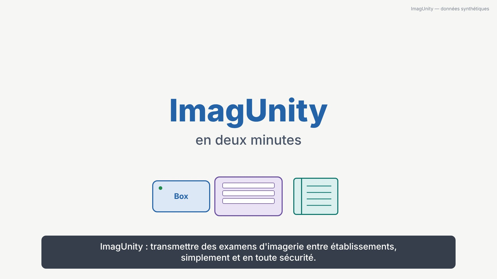
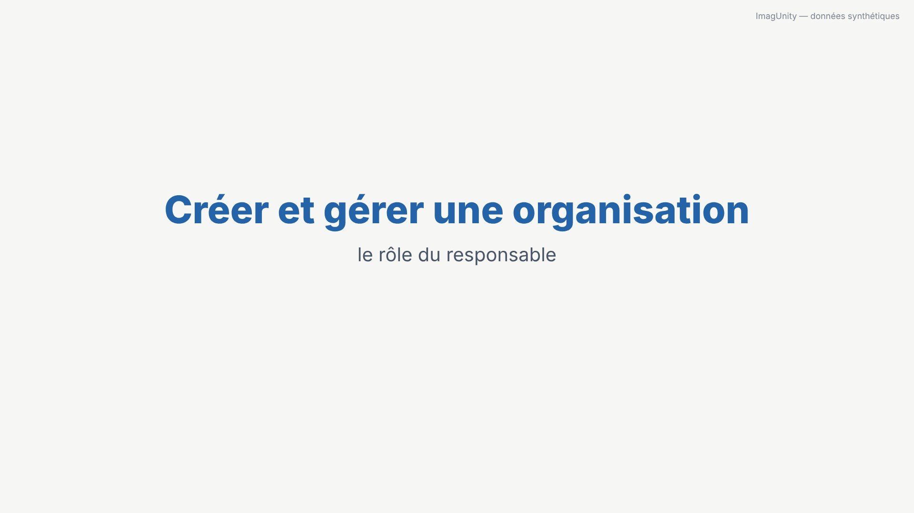
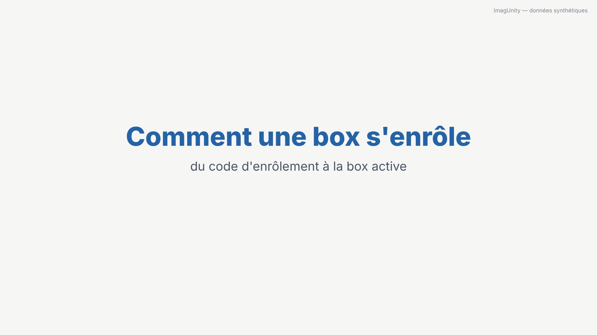
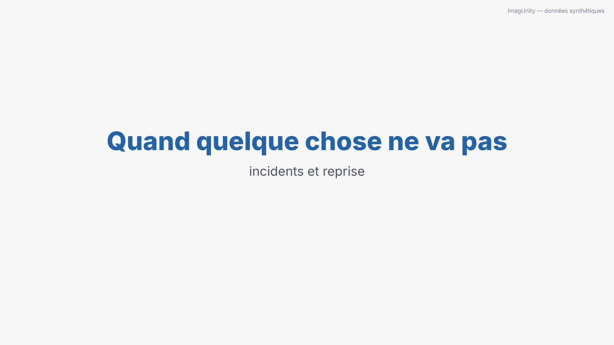
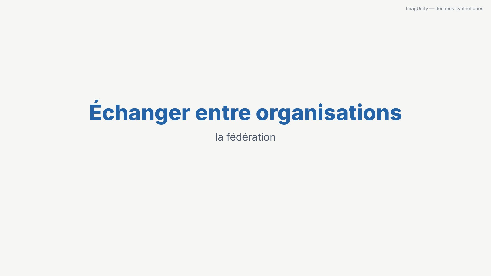

# Films explicatifs

Six courtes vidéos animées qui montrent comment ImagUnity fonctionne, sans lire la spécification. Elles sont muettes, avec sous-titres en français incrustés, et un fichier `.srt` accompagne chacune pour une voix off ou une traduction. Les données sont synthétiques (organisation « chu-exemple », patients fictifs) et les messages affichés sont ceux du logiciel. Le plan des films est dans [plan.md](plan.md).

| | Film | Durée | Pour qui |
|---|---|---|---|
| [](1-vue-ensemble.mp4) | **1. [ImagUnity en deux minutes](1-vue-ensemble.mp4)** : le problème, la poste restante aveugle, les trois composants, le trajet d'un examen, les garanties ([sous-titres](1-vue-ensemble.srt)) | 1 min 56 | tout public |
| [](2-organisation.mp4) | **2. [Créer et gérer une organisation](2-organisation.mp4)** : la clé du responsable, l'annuaire signé, l'interface locale (codes, validations, renouvellements, révocations), les règles communes ([sous-titres](2-organisation.srt)) | 2 min 08 | responsables d'organisation |
| [](3-enrolement.mp4) | **3. [Comment une box s'enrôle](3-enrolement.mp4)** : code d'enrôlement, identité de la box, demande signée avec preuve, signature hors ligne, box active ([sous-titres](3-enrolement.srt)) | 1 min 52 | installateurs, responsables |
| [](4-voyage-examen.mp4) | **4. [Le voyage d'un examen](4-voyage-examen.mp4)** : PACS → box, règles, paquet chiffré, morceaux, annonce signée, retrait vérifié, restitution, accusé ([sous-titres](4-voyage-examen.srt)) | 2 min 56 | équipes d'imagerie, DSI, auditeurs |
| [](5-incidents.mp4) | **5. [Quand quelque chose ne va pas](5-incidents.mp4)** : relais injoignable, box éteinte, PACS figé, box révoquée, donnée altérée ([sous-titres](5-incidents.srt)) | 1 min 52 | exploitants |
| [](6-federation.mp4) | **6. [Échanger entre organisations](6-federation.mp4)** : reconnaissance mutuelle, périmètre, relais autorisés, relais qui ne se parlent pas, refus ([sous-titres](6-federation.srt)) | 1 min 56 | responsables d'organisation |

Format : MP4 (H.264), 1920 × 1080, 30 images par seconde, quelques Mo par film.

## Régénérer un film

Les films sont calculés, pas montés à la main : chaque image est une fonction du temps, décrite dans une page HTML/SVG de [`sources/`](sources/). Les pictogrammes et la charte sont dans [`moteur.js`](sources/moteur.js). Après une modification du logiciel, on corrige le texte ou l'animation, puis on regénère :

```bash
cd docs/films/sources
node rendu.js 4-voyage-examen              # MP4, image de couverture et .srt dans docs/films/
node rendu.js 4-voyage-examen --planche    # une image toutes les 2 s dans planches/, pour relecture
```

Prérequis : Node.js avec Playwright et Chromium, ffmpeg, la police Inter.

Charte : **vert** pour ce qui est chiffré, **orange** pour ce qui est signé, **rouge** pour un refus, **violet** pour le relais, **bleu-vert** pour l'annuaire.
