# Guide du responsable de l'organisation

> Pour la personne qui gère le réseau ImagUnity d'une organisation : elle décide quelles box en font partie, et quelles règles communes elles appliquent. Ce guide présente d'abord ImagUnity et ses composants, puis l'annuaire : à quoi il sert, les tâches courantes, et son interface d'administration, partie par partie.
>
> Les exemples et les captures d'écran utilisent une organisation fictive, « chu-exemple », et uniquement des données synthétiques.
>
> En complément, des [films courts](../films/README.md) montrent en animation la vie d'une organisation, l'enrôlement d'une box et le voyage d'un examen.

**Sommaire**

- [Introduction : ImagUnity en quelques mots](#introduction--imagunity-en-quelques-mots)
- [1. À quoi sert l'annuaire](#1-à-quoi-sert-lannuaire)
- [2. Les tâches courantes du responsable](#2-les-tâches-courantes-du-responsable)
- [3. L'interface d'administration](#3-linterface-dadministration)
- [4. Quand ça ne marche pas](#4-quand-ça-ne-marche-pas)
- [Annexe : les commandes de l'outil du responsable](#annexe--les-commandes-de-loutil-du-responsable)

---

## Introduction : ImagUnity en quelques mots

### Le principe : la poste restante

ImagUnity transporte des examens d'imagerie (DICOM) entre les établissements d'une même organisation, où qu'ils soient, **sans ouvrir aucun port entrant** dans leurs réseaux.

L'établissement qui envoie dépose l'examen, chiffré, sur un relais. L'établissement destinataire vient le chercher quand il est prêt. Chacun n'ouvre que des connexions sortantes, et le relais ne peut pas lire ce qu'il garde : seul le destinataire a la clé.

### Les trois composants

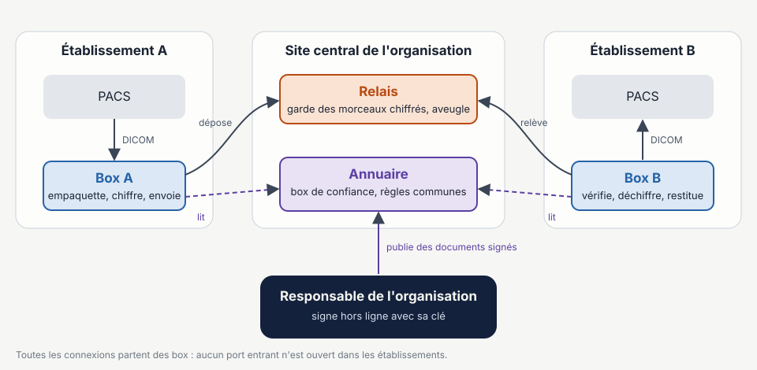

| Composant | Où | Rôle |
|---|---|---|
| **Box** | Une dans chaque établissement, à côté de son PACS | Reçoit les examens du PACS comme une destination DICOM ordinaire. Les empaquette, les chiffre **pour la box destinataire**, puis les dépose sur le relais. Dans l'autre sens, elle télécharge ce qui lui est destiné, vérifie et déchiffre, restitue l'examen à son PACS et envoie un accusé de réception. Une console web montre les transferts en direct. |
| **Relais** | Site central de l'organisation | Une « boîte aux lettres » aveugle. Il garde des morceaux chiffrés et des messages chiffrés le temps que le destinataire les relève, puis les efface. Il n'accepte des dépôts que des box enrôlées dans l'annuaire. |
| **Annuaire** | Site central de l'organisation | La liste **signée** des box de confiance : leur identité, leurs clés, l'adresse où leur écrire. Il diffuse aussi les **règles communes** (priorité des séries, routage) fixées par le responsable. Les box le lisent régulièrement. |

### Le trajet d'un examen

1. Le PACS de l'établissement A envoie l'examen à sa box, comme à n'importe quelle destination DICOM.
2. La **box A** cherche dans l'**annuaire** la box destinataire : ses clés, l'adresse de sa boîte de réception. Elle vérifie que l'entrée est bien signée par le responsable et qu'elle est active.
3. La box A empaquette l'examen, le chiffre pour la box B et le dépose sur le **relais**, puis annonce l'envoi à la box B.
4. La **box B** relève l'annonce et les paquets, vérifie leur empreinte, déchiffre et restitue l'examen à son PACS.
5. La box B renvoie un accusé « restitué » ; le relais efface les morceaux.

L'annuaire intervient à l'étape 2, à chaque échange : une box absente, expirée ou révoquée ne reçoit plus rien et ses messages sont refusés.

### Qui fait quoi

| Rôle | Responsabilités | Documentation |
|---|---|---|
| **Responsable de l'organisation** | Garde la clé de l'organisation. Enrôle, renouvelle et révoque les box. Fixe les règles communes. | Ce guide |
| **Exploitant du site central** | Installe et surveille le relais et l'annuaire, fait les sauvegardes. | [Installation du site central](installation-site-central-rocky10.md) |
| **Exploitant d'une box** | Installe la box de son établissement, la relie à son PACS, recopie le code d'enrôlement donné par le responsable. | [Installation d'une box](installation-box-rocky10.md) |

Dans une petite organisation, une même personne peut tenir plusieurs rôles. La clé de l'organisation, elle, ne doit être confiée qu'au responsable.

---

## 1. À quoi sert l'annuaire

### 1.1 Savoir qui est qui

Entre les box d'une organisation, la confiance ne repose ni sur une adresse IP, ni sur un mot de passe partagé, mais sur une **signature**. Chaque box est **enrôlée** par le responsable : il signe une **entrée** qui la décrit, et l'annuaire publie cette entrée. Avant chaque échange, une box vérifie que l'entrée de l'autre box est signée par le responsable, qu'elle est en cours de validité et qu'elle n'est pas révoquée.

### 1.2 Ce que contient une entrée

| Élément | Signification |
|---|---|
| Identifiant | Un numéro unique (UUID), tiré par la box à sa création |
| Nom | Le nom affiché, par exemple « CHU Exemple — imagerie Nord » |
| Clés publiques | La clé de signature de la box (ses messages sont signés) et sa clé de chiffrement (les examens qui lui sont destinés sont chiffrés pour elle) |
| Adresse | L'adresse de sa boîte de réception sur le relais |
| Groupes | Facultatif : des groupes comme `imagerie-nord` ou `urgences`, pour viser plusieurs box à la fois avec les règles communes |
| Validité | Une date de début et une date de fin, 90 jours par défaut |
| Numéro | Augmente à chaque nouvelle émission de l'entrée (renouvellement, changement de groupes, révocation). Seule l'entrée de numéro le plus haut compte. |
| Révocation | Le cas échéant, la date et le motif |

### 1.3 Ce que l'annuaire garantit

L'annuaire **n'est pas de confiance** : il ne fait que publier des documents signés par le responsable, et les box revérifient tout de leur côté. Un annuaire piraté :

- **ne peut pas** ajouter une box, ni changer les clés d'une box : il n'a pas la clé du responsable ;
- **ne peut pas** faire revenir une ancienne entrée, ni une ancienne version des règles : chaque document porte un numéro croissant, et les box refusent tout retour en arrière ;
- **ne peut pas** imposer des règles : les règles communes sont, elles aussi, signées par le responsable ;
- **peut** en revanche cacher des documents : une nouvelle box n'est alors pas vue, ou une révocation n'arrive pas. C'est pourquoi les entrées ont une validité courte, et pourquoi la console de chaque box montre la date de sa dernière lecture réussie de l'annuaire.

### 1.4 La clé du responsable

Toute la confiance du réseau repose sur **la clé de l'organisation**, détenue par le responsable :

- elle est créée une seule fois (§ 2.1) et **reste hors ligne**, sur le poste du responsable, protégée par une phrase de passe ;
- sa partie publique est installée sur le relais, l'annuaire et chaque box ;
- son **empreinte courte**, de la forme `QZYY-WDJT-LDE4-GY7V-5GPV-5RQW`, est communiquée **hors bande** (téléphone, courrier, en personne) aux exploitants, qui la recopient dans la configuration. Une box ou un relais dont l'empreinte ne correspond pas à la clé installée refuse de démarrer : on ne peut pas lui substituer une autre clé à son insu.

Ni l'annuaire ni son interface ne voient jamais la clé privée : tout ce qui est signé l'est sur le poste du responsable, avec l'**outil du responsable**.

> **L'outil du responsable.** Les commandes de ce guide s'écrivent `admin <commande> …`. Sur le site central, le raccourci `admin` est défini dans le [guide d'installation du site central, § 4](installation-site-central-rocky10.md). Sur une station Windows d'essai, c'est `admin.bat` (`deploy/banc-essai/windows`). La phrase de passe de la clé se saisit au clavier, ou passe par la variable `IMAGUNITY_PHRASE_ORGANISATION`. La publication utilise le compte de l'annuaire, par la variable `IMAGUNITY_ANNUAIRE_COMPTE=responsable:<mot de passe>`.

---

## 2. Les tâches courantes du responsable

Ces tâches se font avec l'outil du responsable, sur son poste. L'interface d'administration (§ 3) montre leur résultat : les demandes en attente, les box, leur statut et leurs groupes.

L'enrôlement est **automatique** dès que la box a reçu un **code d'enrôlement** :

```
 responsable                     installateur de la box            box                          responsable
 code-creer  ──── code ────────► recopie le code dans box.env ──► démarre, envoie sa demande ──► enroler-attente
 (nom, groupes)  (hors bande)                                      à l'annuaire, avec la preuve   (vérifie, signe,
                                                                   du code                        publie)
```

Plus de fichier à faire circuler ni d'empreinte à comparer au téléphone : le code, connu seulement du responsable et de l'installateur, prouve que la demande vient bien de la box prévue.

Toutes ces tâches se font au choix en ligne de commande ou depuis l'**interface locale du responsable**, une page servie par l'outil sur son poste (§ 2.4) : bouton « Valider » par demande, renouvellement et révocation des box, tirage des codes.

### 2.1 Créer la clé de l'organisation (une seule fois)

**Le plus simple : depuis l'interface.** Double-cliquez sur `interface-responsable.bat` (kit du poste du responsable, dossier `poste-responsable` de la livraison ; sur la station d'essai, `interface.bat`). Sans organisation sur le poste, la page s'ouvre sur l'onglet « Démarrage », qui la crée et guide la suite (§ 2.4). La commande ci-dessous fait la même chose en ligne de commande.

```bash
admin organisation-creer --organisation chu-exemple --cles organisation.json
```

```text
Clé du responsable de « chu-exemple » créée : organisation.json (à garder hors ligne, protégée par phrase de passe)
Clé publique, à installer dans les box : organisation.json.pub.json
Empreinte à communiquer hors bande : QZYY-WDJT-LDE4-GY7V-5GPV-5RQW
```

- `--organisation` : l'identifiant de l'organisation, en minuscules, chiffres et tirets.
- La phrase de passe demandée fait au moins 16 caractères. Notez-la en lieu sûr : sans elle, la clé est inutilisable.
- `organisation.json` est la **clé privée** : à garder hors ligne et à sauvegarder sur un support séparé.
- `organisation.json.pub.json` est la **clé publique** : à remettre à l'exploitant du site central et aux exploitants des box, avec l'empreinte.

### 2.2 Préparer une box : le code d'enrôlement

Avant l'installation d'une box, tirez un code pour elle, en fixant son nom et ses groupes :

```bash
admin code-creer --codes codes.json --nom "CHU Exemple — imagerie Nord" --groupes imagerie-nord,urgences
```

```text
Code d'enrôlement de la box « CHU Exemple — imagerie Nord », groupes [imagerie-nord, urgences], valable jusqu'au 2026-12-14 : 2YFL-IRQX-LJOW-27MG-H45K
À donner à l'installateur de la box, qui le recopie dans sa configuration :
  IMAGUNITY_DIRECTORY_ENROLLMENT_CODE=2YFL-IRQX-LJOW-27MG-H45K
```

- **Transmettez le code à l'installateur hors bande** (téléphone, courrier, en personne), avec la clé publique et l'empreinte de l'organisation. Il le recopie dans `box.env` ([installation d'une box, § 6](installation-box-rocky10.md)).
- `codes.json` garde vos codes, avec le nom et les groupes prévus. Rangez-le avec la clé de l'organisation : il n'est lisible que par vous, et il sert à reconnaître les demandes.
- Un code ne sert qu'**une fois**, pour une seule box, et expire au bout de 30 jours (`--validite-jours` pour changer). Majuscules, minuscules, espaces et tirets sont indifférents à la saisie.

| Option de `code-creer` | Rôle | Par défaut |
|---|---|---|
| `--nom` | Nom de la box dans l'annuaire | obligatoire |
| `--groupes` | Groupes de la box, séparés par des virgules : minuscules, chiffres et tirets, 16 groupes au plus | aucun |
| `--validite-jours` | Durée pendant laquelle le code est accepté, de 1 à 365 jours | 30 |

Le code peut aussi se tirer depuis l'interface locale, onglet « Codes d'enrôlement » (§ 2.4), qui liste aussi les codes libres, utilisés et expirés.

Au démarrage, la box envoie seule sa **demande d'enrôlement** à l'annuaire, avec la preuve du code, et la renvoie tant qu'elle n'est pas enrôlée. Elle apparaît dans l'interface, partie « Demandes d'enrôlement en attente » (§ 3.3).

### 2.3 Enrôler les box en attente

Une seule commande traite toutes les demandes en attente :

```bash
admin enroler-attente --cles organisation.json --codes codes.json --annuaire https://annuaire.exemple.org
```

```text
Box « CHU Exemple — imagerie Nord » (nom proposé par la box : « Box Nord (nom local) »), f1ec3bd5-97af-40f6-97d6-064f292d400a
  empreinte STHD-WPBT-WVII-USXL-2V6J-VVIC, code d'enrôlement vérifié, groupes [imagerie-nord, urgences], n° 1, 90 jours
Enrôler cette box ? Tapez « oui » pour confirmer : oui
  Enrôlée et publiée
1 box enrôlée(s), 0 demande(s) laissée(s) de côté
```

Pour chaque demande, l'outil :

1. retrouve le code dans `codes.json` et **vérifie la preuve** : une demande sans code de ce responsable, ou dont la preuve ne correspond pas, est laissée de côté ;
2. refuse un code **expiré**, ou **déjà utilisé**. Un code déjà utilisé ne sert plus qu'à la box qu'il a enrôlée, avec les mêmes clés, et tant qu'elle n'est pas révoquée : il ne réenrôle ni une autre box, ni d'autres clés, ni une box révoquée ;
3. affiche la box et demande « oui » (`--confirmer` pour ne pas demander) ;
4. signe l'entrée avec **le nom et les groupes du code**, la publie, et marque le code comme utilisé.

La box se voit enrôlée à sa lecture suivante de l'annuaire (toutes les 5 minutes par défaut) et cesse d'envoyer sa demande. Elle crée sa boîte de réception sur le relais ; l'exploitant peut ensuite l'appairer avec ses partenaires depuis sa console.

La durée de validité des entrées se règle avec `--validite-jours` (90 jours par défaut).

### 2.4 L'interface locale du responsable

Plutôt qu'en ligne de commande, les tâches courantes peuvent se faire depuis une page web servie par l'outil du responsable, **sur son poste** : valider ou refuser les demandes d'enrôlement, renouveler et révoquer les box, tirer les codes d'enrôlement. Un menu à gauche mène aux sections : « Tableau de bord », « Démarrage », « Demandes », « Box », « Configuration des box » (§ 2.11), « Codes d'enrôlement », « Partenaires » pour la fédération (§ 2.9), et « Aide ». Le bandeau du haut rappelle l'organisation et son empreinte, et dit si l'annuaire répond et si la clé est déverrouillée.

**Sous Windows, sans commande à taper** : le kit du poste du responsable (dossier `poste-responsable` de la livraison, ou [`deploy/poste-responsable`](../../deploy/poste-responsable/LISEZMOI.md)) contient `imagunity-directory.jar`, `reglages.bat` (adresse de l'annuaire, dossier des fichiers) et `interface-responsable.bat`, à lancer d'un double-clic. Seul Java 25 est à installer. Le compte de dépôt et la phrase de passe se saisissent dans la page.

```bash
admin interface --cles organisation.json --codes codes.json --annuaire https://annuaire.exemple.org
```

```text
Interface du responsable : http://127.0.0.1:52817/#jeton=TV1vrcQWjDYVb15-c7tFmhx-giLkf4x3wDy1a-7MNdI
À ouvrir dans le navigateur de ce poste (adresse personnelle, ne pas la partager) ; arrêt par le bouton « Quitter » ou Ctrl+C.
```

Ouvrez cette adresse dans le navigateur du poste (`--ouvrir` l'ouvre directement). Sans `--compte` ni `IMAGUNITY_ANNUAIRE_COMPTE`, le compte de dépôt se saisit dans la page ; il n'est gardé qu'en mémoire, le temps de la session.

#### Tableau de bord

C'est la page d'accueil. En haut, **« À faire »** : ce qui attend une action, le plus urgent d'abord (annuaire injoignable, délégation de fraîcheur qui expire, configuration refusée par une box, demandes d'enrôlement, entrées à renouveler), chacune avec un bouton qui mène au bon endroit. Puis quatre indicateurs (box actives, preuve de fraîcheur, configurations appliquées, partenaires) et la liste des box, filtrable par nom ou par groupe, avec leur état et la version de configuration qu'elles appliquent.

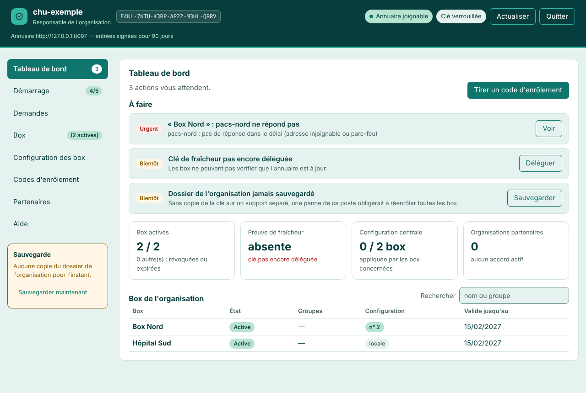

#### Onglet « Démarrage »

Au premier lancement, sans clé d'organisation dans le dossier, seuls les onglets « Démarrage » et « Aide » sont ouverts :

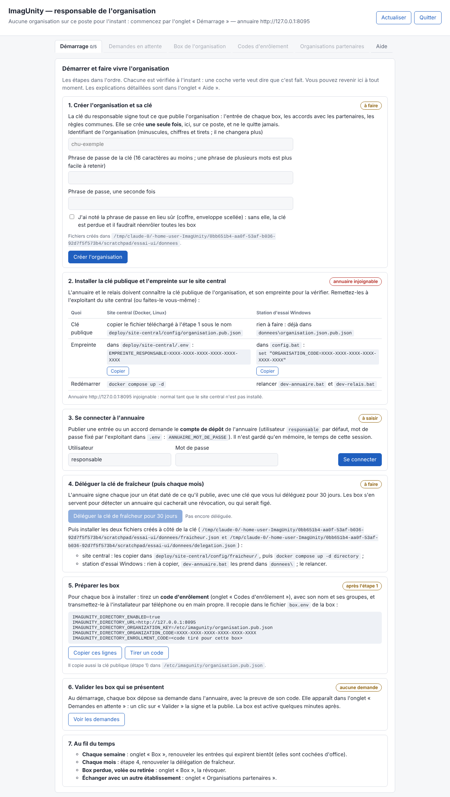

Les étapes, chacune vérifiée à l'instant (coche verte quand c'est fait) :

1. **Créer l'organisation** : identifiant et phrase de passe (deux fois). C'est `organisation-creer`, sans terminal. La page affiche ensuite l'empreinte, l'emplacement des deux fichiers, et propose de télécharger la clé publique sous le nom attendu par le site central (`organisation.pub.json`).
2. **Installer la clé publique et l'empreinte sur le site central** : où déposer le fichier (`deploy/site-central/config/organisation.pub.json`) et la ligne à copier dans `.env` (`EMPREINTE_RESPONSABLE=…`) ; sur la station d'essai, la ligne de `config.bat`. L'étape passe au vert quand l'annuaire publie bien cette clé ; « clé différente » signale un annuaire installé avec une autre.
3. **Se connecter à l'annuaire** avec le compte de dépôt, vérifié auprès de lui.
4. **Déléguer la clé de fraîcheur** (§ 2.10) d'un clic ; `fraicheur.json` et `delegation.json` sont créés à côté de la clé, avec l'endroit où les installer. Au vert quand l'annuaire publie sa preuve ; à renouveler chaque mois (rappel 7 jours avant la fin).
5. **Préparer les box** : les lignes de `box.env` déjà remplies (adresse de l'annuaire, empreinte), et un lien vers les codes d'enrôlement.
6. **Valider les box** qui se présentent.
7. **Au fil du temps** : renouvellements, révocations, partenaires.

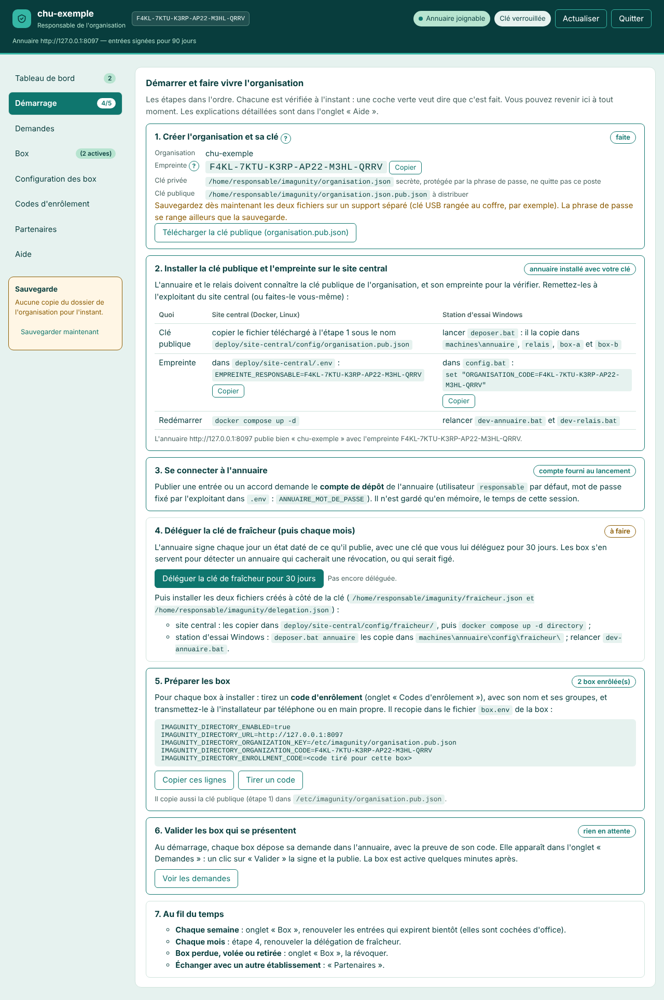

L'onglet « Aide » explique le principe, chaque fichier et sa raison d'être, l'empreinte, la phrase de passe, les groupes, l'enrôlement, la fraîcheur, les partenaires, et que faire en cas de problème.

#### Onglet « Demandes en attente »

L'onglet liste les demandes en attente dans l'annuaire, revérifiées par l'outil :

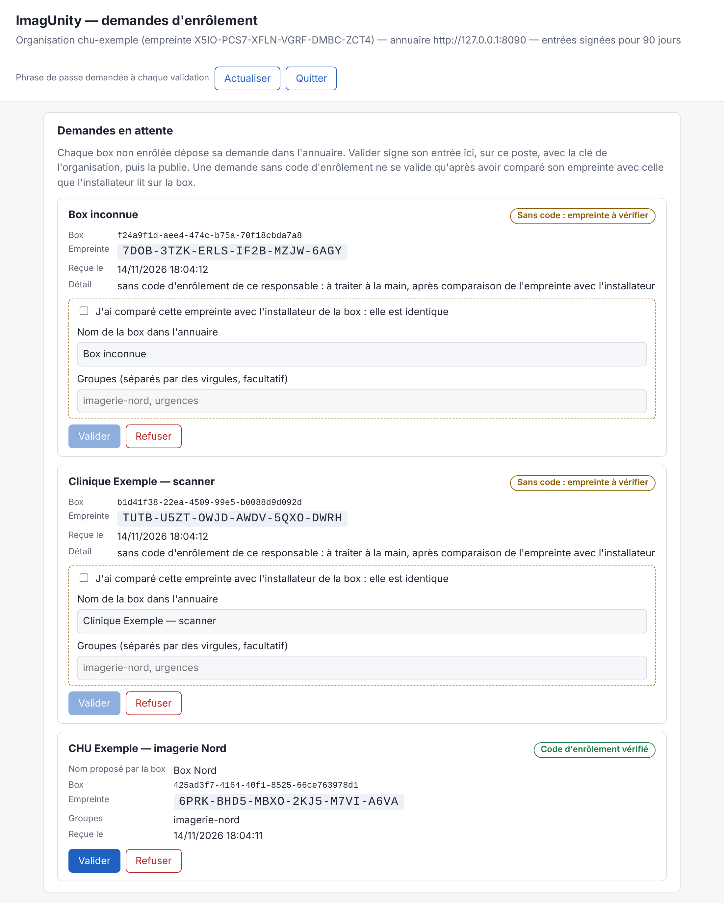

| Étiquette | Signification | Action possible |
|---|---|---|
| **Code d'enrôlement vérifié** | La demande porte la preuve d'un de vos codes, encore valable. Nom et groupes viennent du code. | Valider, Refuser |
| **Sans code : empreinte à vérifier** | La box n'a pas de code de ce responsable | Valider après comparaison de l'empreinte, Refuser |
| **Preuve du code invalide**, **Code déjà utilisé**, **Code expiré** | Comme pour `enroler-attente` (§ 4.2) | Refuser, ou tirer un nouveau code |
| **Box révoquée** | L'identifiant est celui d'une box révoquée : ni un code ni la comparaison de l'empreinte ne la réintègrent | Refuser ; pour réintégrer l'établissement, nouvelle box et nouveau code (§ 2.8) |
| **Identifiant déjà pris par d'autres clés** | Une entrée est déjà publiée pour cet identifiant avec d'autres clés, ou elle n'est pas vérifiable | Refuser : une box réinstallée reçoit une nouvelle identité |
| **Demande illisible ou mal signée** | La demande ne prouve pas la possession des clés qu'elle présente | Refuser |

**Valider** demande la phrase de passe de la clé de l'organisation, signe l'entrée sur ce poste, la publie, et marque le code comme utilisé :

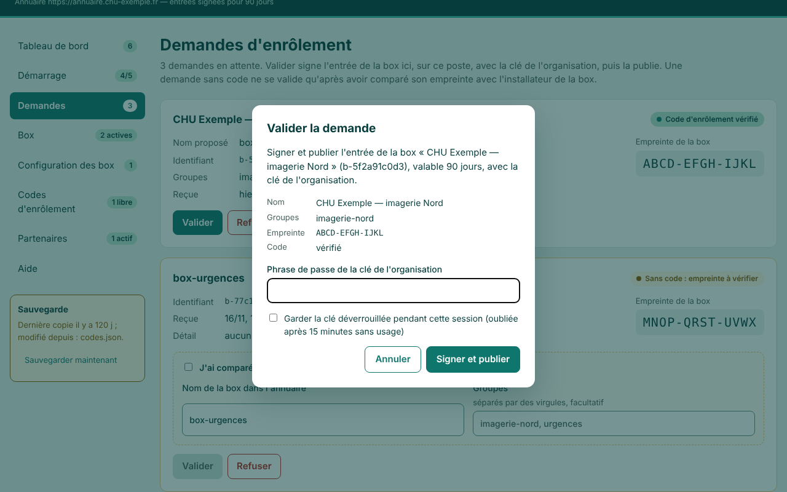

- Une phrase de passe erronée est signalée sans fermer la fenêtre ; rien n'est signé ni publié.
- « Garder la clé déverrouillée pendant cette session » évite de la ressaisir pour chaque box. La clé est oubliée au bout de 15 minutes sans usage, par le bouton « Oublier la phrase », ou à l'arrêt de l'interface.

Pour une **demande sans code**, le bouton « Valider » ne s'active qu'une fois cochée la case « J'ai comparé cette empreinte avec l'installateur de la box : elle est identique ». Appelez l'installateur et faites-lui lire l'empreinte affichée dans la console de sa box : si elle diffère, la demande ne vient pas de sa box, refusez-la. Le nom (celui proposé par la box par défaut) et les groupes se choisissent sur la carte :

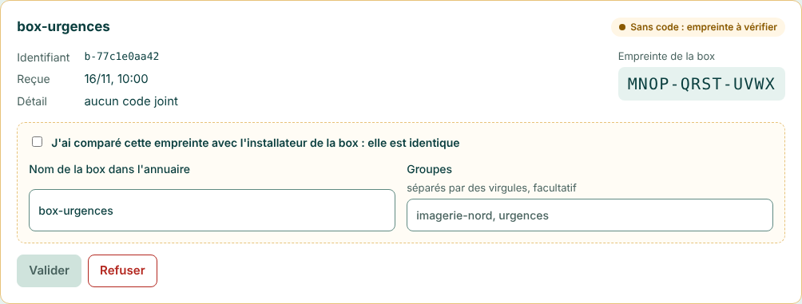

**Refuser** retire la demande de la liste ; les nouveaux envois de cette box sont ignorés pendant 30 jours. À utiliser pour une box inconnue, ou une demande douteuse :

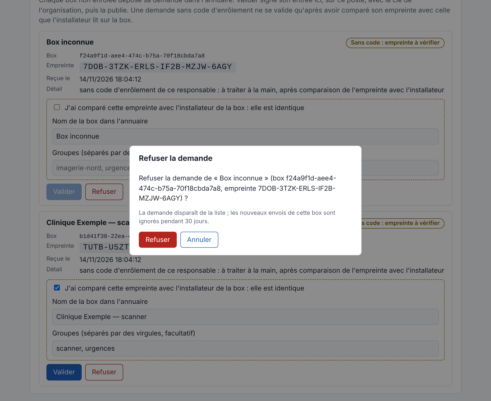

#### Onglet « Box de l'organisation »

Les entrées publiées dans l'annuaire, revérifiées avec la clé de l'organisation (une entrée signée par une autre clé n'est pas montrée) : nom, identifiant et empreinte de chaque box, statut, groupes, date de fin de validité, numéro de l'entrée.

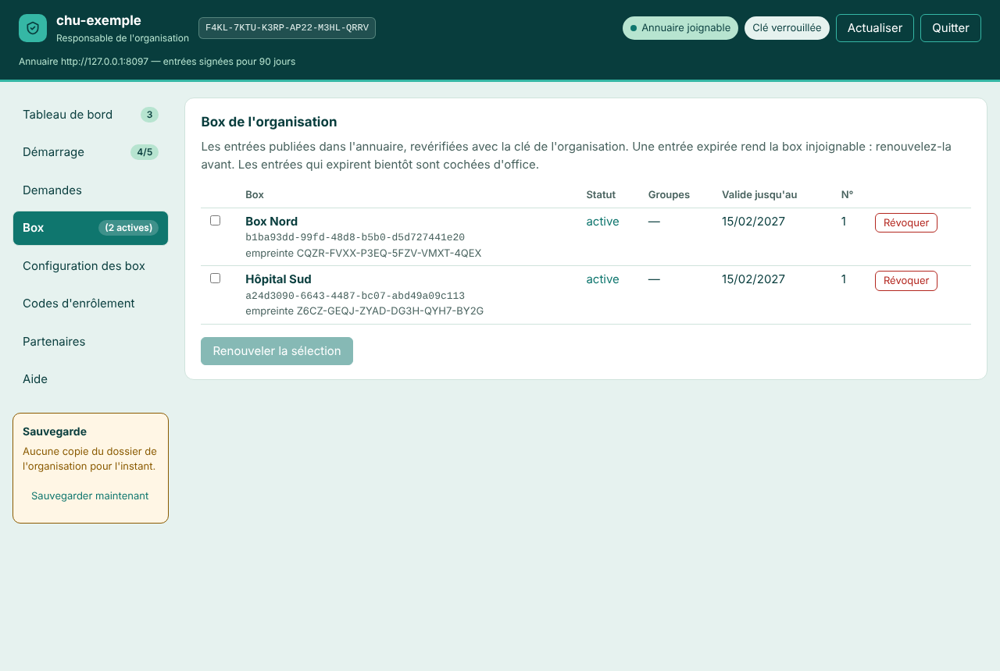

- **Renouveler la sélection** : les entrées actives qui expirent dans les 15 jours, et les entrées expirées, sont cochées d'office ; décochez ou cochez à votre gré. Après la phrase de passe, l'outil relit chaque entrée dans l'annuaire, signe une entrée de numéro suivant (mêmes clés, adresses et groupes, valable `--validite-jours` à partir d'aujourd'hui) et la publie. C'est l'équivalent de `renouveler` (§ 2.6), box par box.
- **Révoquer** : demande un motif, publié dans l'annuaire, et le **nom de la box recopié exactement**, pour éviter de révoquer la mauvaise box d'un clic. C'est l'équivalent de `revoquer` puis `publier` (§ 2.8), sans fichier à manipuler.

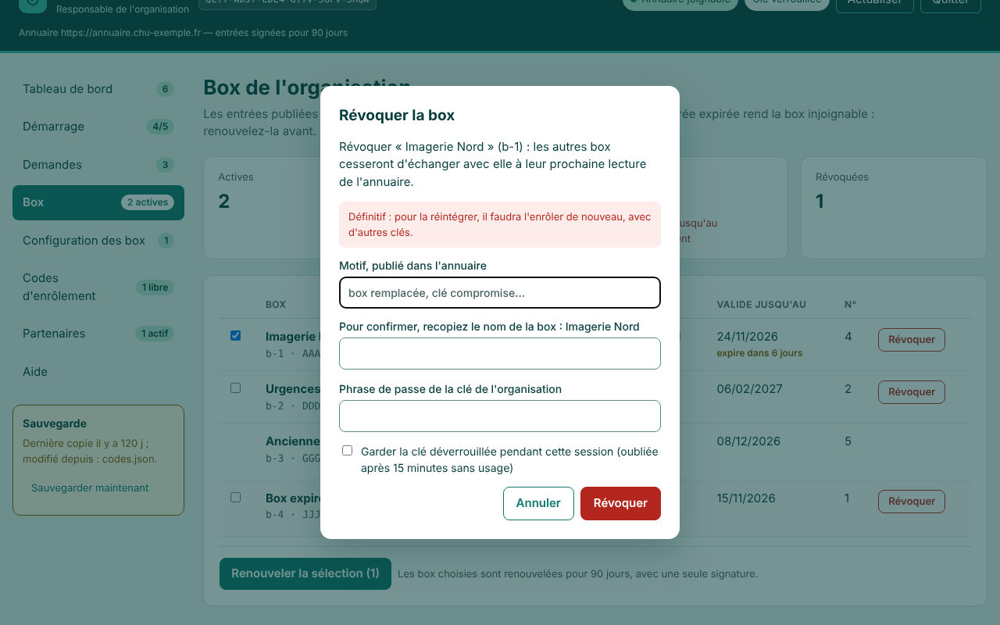

Une box révoquée reste dans la liste, en rouge, avec la date et le motif ; elle ne peut plus être renouvelée ni révoquée de nouveau :

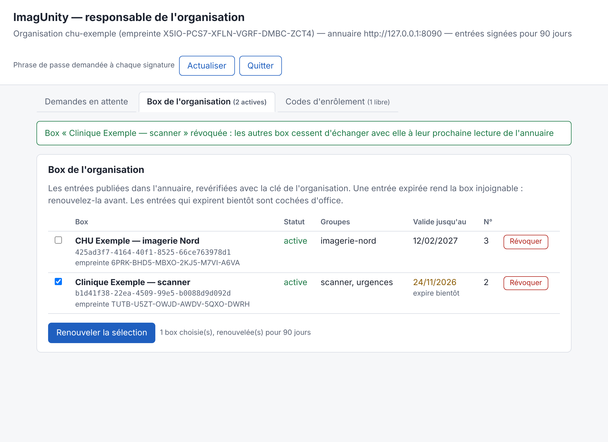

#### Onglet « Codes d'enrôlement »

Le formulaire tire un code pour une box à venir, comme `code-creer` (§ 2.2) : nom de la box, groupes facultatifs, durée de validité (30 jours par défaut, 365 au plus). Le code s'affiche en grand, avec la ligne à recopier dans `box.env` et un bouton pour la copier. Tirer un code ne demande pas la phrase de passe : rien n'est signé, le code est seulement ajouté à `codes.json`.

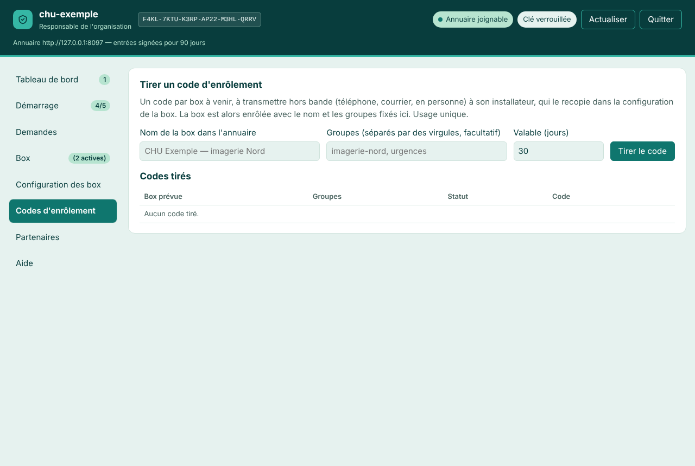

La liste montre tous les codes de `codes.json`, du plus récent au plus ancien :

| Statut | Signification | Action possible |
|---|---|---|
| **libre** | Pas encore utilisé, encore valable ; le code est affiché pour pouvoir le redonner à l'installateur | Retirer |
| **utilisé** | A servi à enrôler la box indiquée ; le code n'est plus affiché | — (gardé pour mémoire) |
| **expiré** | Plus accepté ; tirer un nouveau code si la box n'est pas encore installée | Retirer |

**Retirer** un code le supprime de `codes.json` : une box qui le présenterait ne serait plus reconnue, et sa demande attendrait comme une demande sans code. Utile si un code a été transmis par erreur ou si la box prévue est abandonnée.

#### Ce qui reste sur votre poste

La clé de l'organisation et sa phrase de passe ne quittent jamais le poste : la page ne parle qu'à l'outil qui l'a servie, qui signe lui-même. Seuls les entrées signées (enrôlement, renouvellement, révocation) et les refus partent vers l'annuaire ; `codes.json` reste sur le poste. L'interface n'écoute que sur `127.0.0.1` ; son adresse contient un jeton tiré au démarrage, exigé à chaque appel, si bien qu'aucun autre site ouvert dans le navigateur ni aucun autre utilisateur du poste ne peut s'en servir. Ne partagez pas cette adresse.

| Option de `interface` | Rôle | Par défaut |
|---|---|---|
| `--cles`, `--codes`, `--annuaire` | Comme pour `enroler-attente` | obligatoires |
| `--validite-jours` | Durée de validité des entrées signées | 90 |
| `--port` | Port local de la page ; 0 en tire un libre | 0 |
| `--ouvrir` | Ouvre la page dans le navigateur par défaut | non |

Le compte de l'annuaire vient de `IMAGUNITY_ANNUAIRE_COMPTE`, comme pour les autres commandes. La phrase de passe peut venir de `IMAGUNITY_PHRASE_ORGANISATION` : elle n'est alors plus demandée, ce qui est déconseillé sur un poste partagé.

### 2.5 Enrôler une box sans code

Pour une box installée sans code, ou dont le code a expiré, trois possibilités :

- **tirer un nouveau code** (§ 2.2) et le faire recopier dans sa configuration : la box renvoie alors sa demande avec la preuve, au redémarrage ou à la lecture suivante ;
- **la valider dans l'interface locale** (§ 2.4), après avoir comparé son empreinte avec l'installateur : sa demande est déjà dans l'annuaire, rien à faire circuler ;
- **l'enrôler à la main**, comme avant l'enrôlement automatique.

À la main, l'exploitant télécharge la **demande d'enrôlement** depuis la console de sa box (onglet Annuaire) et vous la transmet. Il vous donne aussi, **hors bande**, l'**empreinte de la box** affichée dans sa console. Vous signez puis publiez :

```bash
admin enroler --cles organisation.json --demande demande-nord.json --groupes imagerie-nord,urgences \
    --sortie entree-nord.json
admin publier --annuaire https://annuaire.exemple.org --entree entree-nord.json
```

`enroler` affiche l'empreinte de la box : **comparez-la avec celle que l'exploitant vous a donnée**. Si elles diffèrent, la demande n'est pas celle de sa box : ne publiez pas l'entrée.

| Option de `enroler` | Rôle | Par défaut |
|---|---|---|
| `--groupes` | Groupes de la box | aucun |
| `--validite-jours` | Durée de validité de l'entrée | 90 |
| `--serie` | Numéro de l'entrée : 1 à l'enrôlement, puis le numéro suivant à chaque nouvelle émission | 1 |

### 2.6 Renouveler les entrées avant leur expiration

Une entrée expirée rend la box injoignable : les autres box refusent de lui envoyer. Une commande renouvelle d'un coup toutes les entrées actives qui expirent bientôt, avec les mêmes clés, adresses et groupes :

```bash
admin renouveler --cles organisation.json --annuaire https://annuaire.exemple.org
```

```text
« CHU Exemple — imagerie Nord » (f1ec3bd5-97af-40f6-97d6-064f292d400a) : expire le 2026-11-29
Renouveler ces 1 entrée(s) pour 90 jours ? Tapez « oui » : oui
1 entrée(s) renouvelée(s)
```

- Par défaut, elle retient les entrées qui expirent dans les **15 jours** (`--avant-jours`), et les renouvelle pour **90 jours** (`--validite-jours`).
- Une box révoquée n'est jamais renouvelée.
- Le renouvellement reporte dans l'entrée les **versions du protocole** que la box annonce dans son dernier compte rendu. Après la mise à jour d'une box vers une nouvelle version du protocole, renouvelez son entrée pour que les autres box le sachent.
- Lancez-la régulièrement, par exemple chaque semaine : la colonne « Statut » de l'interface montre les box expirées (§ 3.4).
- Depuis l'interface locale, onglet « Box de l'organisation » (§ 2.4), les entrées qui expirent bientôt sont cochées d'office : un bouton les renouvelle.

### 2.7 Changer les groupes d'une box

Signez une nouvelle entrée de la box avec le **numéro suivant** et les nouveaux groupes, puis publiez-la :

```bash
admin enroler --cles organisation.json --demande demande-nord.json --groupes imagerie-nord \
    --serie 2 --sortie entree-nord-2.json
admin publier --annuaire https://annuaire.exemple.org --entree entree-nord-2.json
```

Il faut pour cela la demande d'enrôlement de la box : téléchargez-la depuis sa console. Les règles communes qui visent ces groupes s'appliquent alors à la box, ou cessent de s'appliquer, à sa lecture suivante de l'annuaire.

### 2.8 Révoquer une box

À faire sans attendre si une box est perdue, volée, compromise, ou si un établissement quitte l'organisation :

```bash
admin revoquer --cles organisation.json --entree entree-nord.json --motif "Box volée" --sortie revocation-nord.json
admin publier --annuaire https://annuaire.exemple.org --entree revocation-nord.json
```

- `--entree` : la **dernière** entrée publiée de la box. Si vous n'avez pas le fichier, téléchargez-la depuis l'annuaire : `https://annuaire.exemple.org/directory/v1/entries/<identifiant de la box>`. La révocation reçoit automatiquement le numéro suivant.
- Les autres box voient la révocation à leur lecture suivante de l'annuaire et refusent dès lors tout échange avec cette box. Le relais refuse aussi ses dépôts.
- Dans l'interface, la box passe au statut « révoquée ». Une box révoquée n'envoie plus de demande d'enrôlement.

Depuis l'interface locale, onglet « Box de l'organisation » (§ 2.4), le bouton « Révoquer » fait les deux étapes d'un coup, après le motif et le nom de la box recopié.

Pour réintégrer plus tard un établissement, mieux vaut repartir d'une **nouvelle** box (nouvelle identité, nouveau code) que réutiliser celle qui a été révoquée.

### 2.9 Échanger avec une autre organisation (fédération)

Les box de deux organisations différentes (deux régions, deux pays) peuvent échanger des examens si **les deux responsables se reconnaissent mutuellement**. Rien ne relie les relais entre eux : la box émettrice dépose l'annonce directement sur le relais du destinataire, et la box destinataire retire les morceaux sur le relais de l'émetteur. Le principe et ses limites sont dans la [note de fédération](../reference/federation-organisations.md).

**Ce que signe chaque responsable : une reconnaissance**, qui fixe :

- la **clé du partenaire**, identifiée par son empreinte, à comparer de vive voix (téléphone, visioconférence) avec le responsable partenaire ;
- l'**adresse de son annuaire**, où le service d'annuaire de votre organisation lira ses entrées ;
- ses **relais autorisés** : une box du partenaire qui publierait une autre adresse est ignorée. Ce choix fixe aussi la juridiction où peuvent séjourner les morceaux (par exemple, aucun relais hors UE) ;
- le **périmètre** : les groupes de vos box autorisés à échanger avec lui, et les groupes de ses box acceptés. `*` veut dire tous. **Sans groupes, aucun échange** ;
- une validité (90 jours par défaut, comme les entrées), renouvelable et révocable.

```bash
admin reconnaitre --cles organisation.json --annuaire https://annuaire.exemple.org \
    --partenaire bourgogne-fc.pub.json --annuaire-partenaire https://annuaire.bourgogne-fc.example \
    --relais https://relais.bourgogne-fc.example \
    --groupes-locaux imagerie-nord --groupes-partenaire neurochirurgie
```

```text
Organisation partenaire « bourgogne-fc », empreinte Q2EJ-PEZ7-GJE3-UW6C-QL7O-J7GV
  relais autorisés : https://relais.bourgogne-fc.example
  groupes locaux : imagerie-nord ; groupes du partenaire : neurochirurgie
  nouvelle reconnaissance, valable 90 jours
Empreinte vérifiée avec le responsable partenaire, hors bande ? Tapez « oui » : oui
Reconnaissance signée et publiée. L'échange ne marchera que lorsque « bourgogne-fc » aura reconnu cette organisation à son tour.
```

- La clé du partenaire est son fichier `organisation.json.pub.json`, qu'il vous transmet. Seule compte l'empreinte confirmée de vive voix.
- Relancer `reconnaitre` avec d'autres groupes, d'autres relais ou pour une nouvelle période **réémet** la reconnaissance (numéro suivant).
- `reconnaissances` liste les accords et leur état. `reconnaissance-revoquer --empreinte <empreinte> --motif <texte>` met fin à un accord ; relancer `reconnaitre` le rétablit.
- L'interface locale fait la même chose, onglet « Organisations partenaires » : coller la clé, lire l'empreinte, cocher la comparaison, signer.

**Ensuite**, sans rien d'autre à faire de votre côté :

1. le service d'annuaire de votre organisation lit les entrées du partenaire et les relaie à vos box et à votre relais ;
2. les box couvertes par l'accord apparaissent dans la console des exploitants, avec le nom de leur organisation ; l'exploitant les **appaire** comme une box de l'organisation ;
3. votre relais accepte que les box du partenaire couvertes par l'accord **déposent des messages** dans les files de vos box. C'est tout : elles n'y créent ni file ni morceau ;
4. chaque box vérifie tout elle-même : signature de l'entrée par la clé de l'accord, périmètre, relais, état.

**Un échange ne marche que si les deux responsables ont signé.** Si seul l'un l'a fait, le relais de l'autre refuse les dépôts : la box émettrice garde ses messages et l'écrit dans son journal (« accord à sens unique »).

**Un identifiant de box n'appartient qu'à une organisation.** Si le partenaire publie une entrée sous l'identifiant d'une de vos box, ou de celle d'un autre partenaire, cette entrée est écartée, et la console des box le signale (« identifiant(s) de box revendiqué(s) par deux organisations »). Prévenez le responsable partenaire, et en cas de doute révoquez l'accord.

Avant toute fédération réelle, chaque organisation installe sa clé de fraîcheur (§ 2.10). Les limites de débit du relais sont actives par défaut.


### 2.10 Déléguer la clé de fraîcheur (chaque mois)

L'annuaire n'étant pas de confiance, une box ne peut pas savoir seule si l'entrée qu'on lui sert est la dernière : un annuaire pourrait resservir l'entrée d'une box d'avant sa révocation. La **preuve de fraîcheur** l'empêche. C'est un état daté du plus haut numéro de chaque entrée et reconnaissance, signé par une clé que vous **déléguez** au service d'annuaire pour 30 jours. Votre clé, elle, reste hors ligne.

```bash
admin fraicheur-deleguer --cles organisation.json --sortie-cle fraicheur.json --sortie-delegation delegation.json
```

```text
Clé de fraîcheur n° 1 déléguée jusqu'au 2026-12-31 : fraicheur.json et delegation.json
```

Remettez les deux fichiers à l'exploitant du site central, qui les installe ([installation du site central, § 10 bis](installation-site-central-rocky10.md)). Puis vérifiez :

```bash
admin fraicheur-verifier --cles organisation.json --annuaire https://annuaire.exemple.org
```

```text
Preuve de fraîcheur valide, signée il y a 3 min par la clé déléguée n° 1 (jusqu'au 2026-12-31) : 12 box, 1 reconnaissance(s)
La preuve correspond aux entrées et reconnaissances publiées
```

- **Renouvelez chaque mois**, en relançant `fraicheur-deleguer` avec le même fichier de délégation (numéro suivant). Une délégation expirée arrête les échanges de toutes les box au bout de 48 h : c'est voulu, un annuaire figé ne doit pas être cru.
- **Lancez `fraicheur-verifier` régulièrement.** Un écart (« Écart : box … publiée au n° 3, preuve au n° 2 ») signale un annuaire qui ne dit pas la même chose à tout le monde : prévenez l'exploitant, et renouvelez la délégation sur une machine saine.
- Dans la console de chaque box, la ligne « Fraîcheur de l'annuaire » montre la date de la dernière preuve. Pour chaque organisation partenaire, la fraîcheur de son annuaire est aussi affichée.
- Si votre site central réserve la lecture de l'annuaire (installation du site central, § 10 ter), la clé de fraîcheur sert aussi à signer les lectures de votre annuaire chez vos partenaires : sans elle, il ne lit plus leurs entrées.


---

### 2.11 Configurer les box depuis l'interface : nœuds et routes DICOM

Plutôt que de modifier le fichier `box.env` de chaque box sur place, configurez-les toutes depuis l'interface du responsable, onglet **« Configuration des box »**. La box applique la configuration à sa lecture suivante de l'annuaire, sans redémarrage.

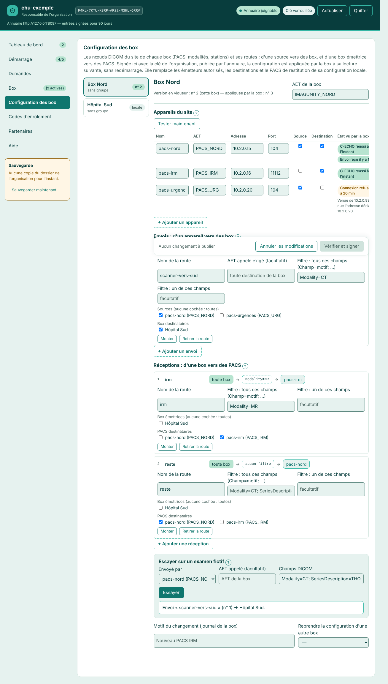

1. **Choisissez la box** dans la liste de gauche ; son étiquette donne la version qu'elle applique, « locale » si elle n'a pas encore de configuration centrale, ou « refus » en rouge. À droite, la ligne d'état précise la version en vigueur et le dernier refus.
2. **Déclarez les nœuds DICOM de son site** : un nom, l'AET, l'adresse et le port, et les rôles.
   - Une **source** a le droit d'envoyer à la box. Si vous indiquez son adresse, seul ce poste peut le faire sous cet AET.
   - Une **destination** reçoit les examens restitués par la box.
3. **Envois** (routes sortantes) : d'une source (ou de toutes) vers une ou plusieurs box, de votre organisation ou d'un partenaire.
   - Un filtre est facultatif : `Modality=CT; SeriesDescription=*THORAX*`.
   - Un AET appelé exigé est facultatif aussi : utile pour garder une destination déjà réglée dans le PACS, comme `IU_TO_B`.
   - Les box désignées sont appairées automatiquement.
4. **Réceptions** (routes entrantes) : d'une box émettrice (ou de toutes) vers un ou plusieurs PACS, avec un filtre. Par exemple, les IRM du CHU Sud vont au PACS IRM et tout le reste au PACS principal. Sans route entrante, la box restitue au PACS de sa configuration locale.
   - En tête de chaque envoi et de chaque réception, une ligne résume la route : de → filtre → vers. Elle suit vos saisies.
5. **L'ordre compte** : la première route qui correspond s'applique. Le bouton « Monter » change l'ordre.
6. **« Vérifier et signer »**, dans la barre du bas qui compte les changements non publiés (« Annuler les modifications » revient à la version en vigueur). La fenêtre liste ce qui change par rapport à cette version : ajouts (+), retraits (−), modifications champ par champ (~) et changements d'ordre (↕). Cochez « J'ai relu ces changements », saisissez la phrase de passe, puis « Signer et publier ». Le document vise cette box seule et garde ses règles de priorité. Une erreur, comme un mot-clé DICOM inconnu dans un filtre, est signalée avant toute application.

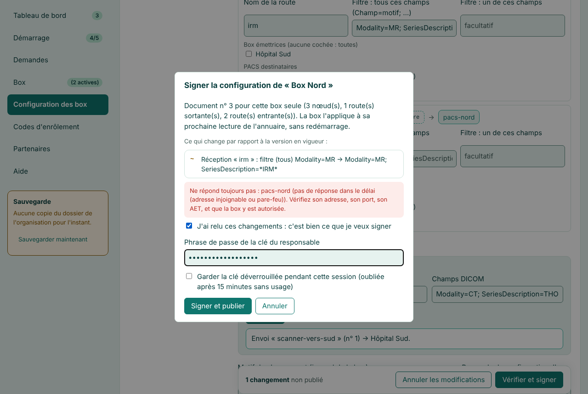

- **Reprendre la configuration d'une autre box** copie ses nœuds et ses routes pour partir d'un modèle. Vérifiez ensuite les adresses, qui sont propres à chaque site.
- Restent dans `box.env` : l'adresse et le port d'écoute de la box, et le compte DICOMweb.
- Une fois une box configurée ici, gérez aussi ses règles d'ici. Un document plus récent publié pour un groupe depuis l'interface d'administration remplacerait ses nœuds et ses routes ([configuration centralisée, § 11](../reference/configuration-centralisee.md#11-nœuds-et-routes-dicom)).

## 3. L'interface d'administration

### 3.1 Se connecter

L'interface est à l'adresse **`https://<annuaire>/admin/`**, par exemple `https://annuaire.exemple.org/admin/`.

- Le navigateur demande le **compte du responsable** sur l'annuaire : l'identifiant (`responsable` par défaut) et le mot de passe fixé à l'installation du site central (`ANNUAIRE_MOT_DE_PASSE`).
- Sur le site central, l'interface n'est ouverte que depuis le **réseau d'administration** (`RESEAU_ADMIN`). Depuis un autre poste, la page est refusée.

L'interface montre les **demandes d'enrôlement en attente** et les **box** de l'annuaire, et sert à la **configuration centralisée** : préparer les règles communes, les essayer, publier une version signée. Elle **ne signe rien** : enrôlement et signature des règles se font avec l'outil du responsable, sur son poste (§ 2).

### 3.2 L'en-tête


| Élément | Signification |
|---|---|
| **Organisation** | L'identifiant de l'organisation, celui de la clé du responsable |
| **Prochaine version** | Le numéro que portera le prochain document de règles préparé. Les numéros sont croissants ; une box n'applique jamais une version plus ancienne que celle qu'elle applique déjà. |
| **Actualiser** | Relit l'état de l'annuaire : statut des box, comptes rendus, versions publiées. La page ne se met pas à jour seule. |

### 3.3 Les demandes d'enrôlement en attente

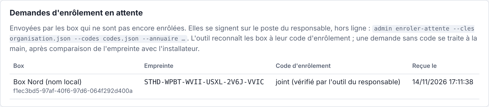

Les box pas encore enrôlées qui ont envoyé leur demande. Elles se traitent avec `enroler-attente` (§ 2.3) ou depuis l'interface locale du responsable (§ 2.4) ; cette page de l'annuaire ne fait que les montrer, car la clé de l'organisation n'est jamais confiée à l'annuaire.

| Colonne | Signification |
|---|---|
| **Box** | Le nom proposé par la box (son nom local), et son identifiant. Le nom publié sera celui du code d'enrôlement. |
| **Empreinte** | L'empreinte de la box, la même que dans sa console |
| **Code d'enrôlement** | « joint » : la box a envoyé la preuve d'un code, que l'outil du responsable vérifiera. « aucun » : la box n'a pas de code ; à valider dans l'interface locale ou à enrôler à la main, après comparaison de l'empreinte, ou en lui donnant un code (§ 2.4, § 2.5). |
| **Reçue le** | La date de la dernière demande ; une box la renvoie tant qu'elle n'est pas enrôlée |

Une demande disparaît dès que l'entrée de la box est publiée, ou qu'elle est refusée depuis l'interface locale (les envois de la box sont alors ignorés 30 jours). Une demande sans suite est effacée au bout de 14 jours ; la box la renvoie si elle tourne toujours.

L'annuaire ne peut pas vérifier les codes : il ne les connaît pas. N'importe qui pouvant joindre l'annuaire peut donc déposer une demande, mais seule une demande portant la preuve d'un de vos codes est enrôlée par `enroler-attente`, et une demande sans code ne se valide dans l'interface locale qu'après comparaison de l'empreinte.

### 3.4 La liste des box


| Colonne | Signification |
|---|---|
| **Box** | Le nom de la box, et son identifiant en dessous |
| **Groupes** | Les groupes fixés dans son entrée (§ 2.2, § 2.7) ; « — » si elle n'en a pas |
| **Statut** | L'état de son entrée, ci-dessous |
| **Version appliquée** | Ce que la box applique, d'après son dernier compte rendu, ci-dessous |
| **Dernier refus** | La dernière version que la box a refusée, et pourquoi ; « — » s'il n'y en a pas |
| **Compte rendu** | La date du dernier compte rendu reçu de la box |

**Statut**

| Statut | Signification | Que faire |
|---|---|---|
| **active** | Entrée valide : la box échange normalement | — |
| **pas encore valide** | La date de début de l'entrée n'est pas atteinte | Attendre, ou vérifier l'heure du poste qui a signé |
| **expirée** | La date de fin est passée : les autres box refusent de lui envoyer | Renouveler l'entrée (§ 2.6) |
| **révoquée** | L'entrée a été révoquée (§ 2.8) | — |

**Version appliquée**

| Affichage | Signification |
|---|---|
| **n° 2 (date)** | La box applique la version 2 des règles communes, depuis cette date |
| **configuration locale** | Aucune version ne vise la box (ou elle est verrouillée sur sa configuration locale) : elle applique ses propres règles |
| **pas de compte rendu** | La box n'a encore jamais rendu compte : elle vient d'être enrôlée, n'a pas encore démarré, ou ne joint pas l'annuaire |

Chaque box envoie un compte rendu **signé par elle-même** à chaque changement, et au moins une fois par heure. Un compte rendu qui date de plusieurs heures signale une box arrêtée, ou qui ne joint plus l'annuaire (§ 4.4).

Dans l'exemple ci-dessus, la « Clinique Exemple des Lilas » applique la version 1 et a **refusé** la version 2 : elle garde la version 1 en attendant (§ 4.4). Le « Centre Exemple de téléradiologie » est révoqué.

### 3.5 Préparer un brouillon de règles

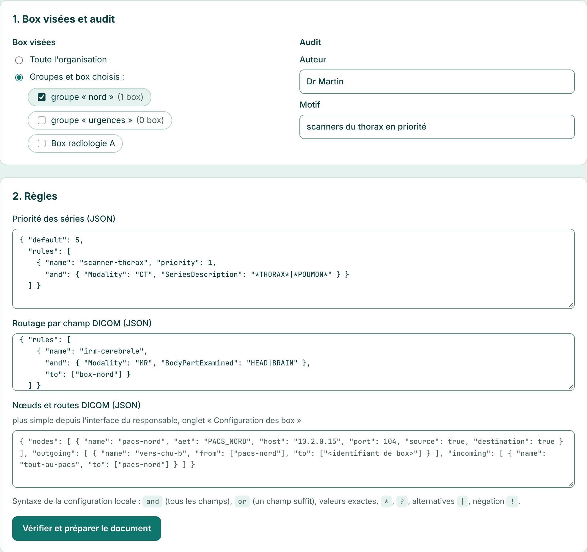

**Box visées**

- **Toute l'organisation** : toutes les box actives, y compris celles enrôlées plus tard.
- **Groupes et box choisis** : cocher un ou plusieurs groupes (le nombre de box actives de chaque groupe est indiqué) et, au besoin, des box une à une. Une box est visée si elle est cochée ou si elle appartient à un groupe coché. Seules les box actives sont proposées.

**Audit**

- **Auteur** : votre nom ; il figure dans le document signé et dans l'historique.
- **Motif** : la raison du changement, en une phrase. Il aide les exploitants des box à comprendre ce qui a changé.

**Priorité des séries (JSON)**

Les séries les plus utiles au diagnostic partent et sont restituées en premier. Une règle donne une priorité de **1 (la plus haute) à 9 (la plus basse)** aux séries qui correspondent ; **la première règle qui correspond s'applique**. `default` est la priorité des séries qu'aucune règle ne couvre (5 si absent).

```json
{ "default": 5,
  "rules": [
    { "name": "scanner-thorax", "priority": 1,
      "and": { "Modality": "CT", "SeriesDescription": "*THORAX*|*POUMON*" } },
    { "name": "localisateurs-en-dernier", "priority": 9,
      "or": { "ImageType": "*LOCALIZER*", "SeriesDescription": "*SCOUT*|*TOPO*" } }
  ] }
```

Ici : les scanners du thorax passent en priorité 1 ; les images de repérage (localisateurs, scouts, topogrammes) passent en dernier ; tout le reste est en priorité 5.

**Routage par champ DICOM (JSON)**

Sur sa **destination de routage** (une destination DICOM réglée par l'exploitant de la box), la box choisit elle-même le destinataire d'après le contenu de l'examen. **La première règle qui correspond s'applique** ; `to` donne le ou les partenaires destinataires, sous **le nom qu'ils portent dans chaque box visée** (le nom donné à l'appairage). Ces partenaires doivent être appairés sur les box visées.

```json
{ "rules": [
    { "name": "irm-cerebrale",
      "and": { "Modality": "MR", "BodyPartExamined": "HEAD|BRAIN" },
      "to": ["box-nord"] }
  ] }
```

Ici : les IRM du crâne sont envoyées au partenaire `box-nord`.

**Laisser un bloc vide** garde la configuration locale des box pour cet aspect : un document peut ne fixer que la priorité, ou que le routage. Il doit fixer au moins l'un des deux.

**Écrire une condition**

| Élément | Exemple | Signification |
|---|---|---|
| `and` | `{ "Modality": "CT", "BodyPartExamined": "CHEST" }` | **Tous** les champs doivent correspondre |
| `or` | `{ "ImageType": "*LOCALIZER*", "SeriesDescription": "*SCOUT*" }` | **Un** champ suffit |
| Valeur exacte | `"CT"` | La valeur du champ est exactement celle-ci (majuscules et minuscules confondues) |
| `*` | `"*THORAX*"` | N'importe quelle suite de caractères |
| `?` | `"CT?"` | Un seul caractère quelconque |
| `\|` | `"HEAD\|BRAIN"` | L'une ou l'autre des valeurs |
| `!` | `"!CT"` | Tout sauf cette valeur |

Les champs se désignent par leur **mot-clé DICOM** : `Modality`, `SeriesDescription`, `BodyPartExamined`, `InstitutionName`, `ImageType`… Un mot-clé mal orthographié est refusé dès la préparation (§ 4.1). Le nom d'une règle (`name`) commence par une lettre ou un chiffre et ne contient que des lettres, chiffres, `.`, `_` et `-`.

**Vérifier et préparer le document**

Le bouton vérifie les règles exactement comme le feront les box, puis prépare le document numéroté :

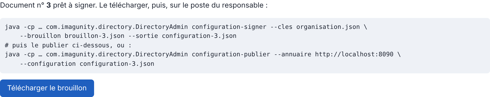

Cliquez sur **Télécharger le brouillon** (fichier `brouillon-3.json`), puis passez à la signature, sur votre poste.

### 3.6 Signer le document, hors ligne

Sur le poste du responsable, avec la clé de l'organisation :

```bash
admin configuration-signer --cles organisation.json --brouillon brouillon-3.json --sortie configuration-3.json
```

L'outil affiche un résumé (version, box visées, règles), puis **le document exact** à signer, et demande de taper « oui ».

**Relisez le document affiché, pas seulement le résumé.** Le brouillon vient de l'interface, qui pourrait avoir été modifiée par un attaquant : c'est ce que vous lisez ici, sur votre poste, qui sera signé et appliqué par les box. En cas de doute, répondez autre chose que « oui » : rien n'est signé.

### 3.7 Essayer les règles

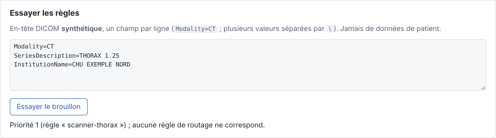

Avant de signer, on peut essayer le brouillon sur un exemple :

- écrire un **en-tête DICOM fictif**, un champ par ligne (`Modality=CT`), plusieurs valeurs séparées par `\` ;
- cliquer sur **Essayer le brouillon** ;
- le résultat indique la priorité obtenue et la règle qui l'a donnée, et le destinataire choisi par le routage, ou qu'aucune règle ne correspond.

**N'y mettez jamais de données de patient** : un en-tête inventé suffit.

### 3.8 Publier le document signé


Choisissez le fichier signé (`configuration-3.json`) et cliquez sur **Publier**. L'annuaire revérifie la signature et refuse un numéro de version déjà dépassé. Équivalent en ligne de commande :

```bash
admin configuration-publier --annuaire https://annuaire.exemple.org --configuration configuration-3.json
```

Les box visées lisent le document à leur lecture suivante de l'annuaire, le vérifient et l'appliquent **sans redémarrer**. Après quelques minutes, cliquez sur **Actualiser** : la colonne « Version appliquée » montre le nouveau numéro pour chaque box qui l'a appliqué, ou la raison d'un refus.

### 3.9 Les versions publiées


Chaque version publiée apparaît avec son numéro, sa date, les box visées, l'auteur, le motif et le nombre de règles (« priorité locale » ou « routage local » quand le bloc était vide).

**Reprendre comme brouillon** recopie les règles et les box visées de cette version dans le brouillon, pour la modifier ou la republier. Le document préparé reçoit alors un **nouveau numéro** : on ne revient pas en arrière en republiant un ancien numéro, on publie une nouvelle version qui reprend d'anciennes règles.

---

## 4. Quand ça ne marche pas

Les erreurs s'affichent dans un bandeau en haut de la page :

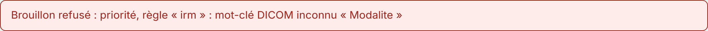

### 4.1 Le brouillon est refusé

| Message | Cause | Solution |
|---|---|---|
| « Brouillon refusé : Règle invalide : … mot-clé DICOM inconnu « Modalite » » | Mot-clé DICOM mal orthographié | Corriger le mot-clé (`Modality`) |
| « Brouillon refusé : Règle invalide : … sans priorité » | Règle de priorité sans champ `priority` | Ajouter une priorité de 1 à 9 |
| « … aucune box visée » | « Groupes et box choisis » sans aucune case cochée | Cocher au moins un groupe ou une box, ou choisir « Toute l'organisation » |
| « Configuration vide : ni priorité ni routage » | Les deux blocs sont vides | Remplir au moins un bloc |
| « Configuration : priorité par défaut hors de 1 à 9 » | `default` invalide | Mettre une valeur de 1 à 9 |
| « Priorité : JSON invalide (…) » ou « Routage : JSON invalide (…) » | Virgule, guillemet ou accolade manquante | Corriger la syntaxe du bloc indiqué |

### 4.2 Une demande d'enrôlement est laissée de côté

Messages de `enroler-attente` (les mêmes cas apparaissent en étiquette dans l'interface locale, § 2.4) :

| Message | Cause | Solution |
|---|---|---|
| « sans code d'enrôlement de ce responsable » | La box n'a pas de code, ou un code tiré par quelqu'un d'autre, ou `--codes` ne désigne pas le bon fichier | Lui donner un code (§ 2.2), ou la valider dans l'interface locale ou à la main, après comparaison de l'empreinte (§ 2.4, § 2.5) |
| « preuve du code invalide : demande refusée » | La demande ne correspond pas au code : demande fabriquée par un tiers, ou code mal recopié | Vérifier avec l'installateur le code recopié dans `box.env` ; en cas de doute, ne pas enrôler cette box |
| « code déjà utilisé par la box … » | Le code a déjà servi à enrôler une autre box | Tirer un nouveau code pour cette box |
| « code déjà utilisé par cette box avec d'autres clés » | La box enrôlée avec ce code présente d'autres clés : réinstallée, ou quelqu'un d'autre détient le code | Refuser. Si l'établissement confirme une réinstallation, tirer un nouveau code |
| « code déjà utilisé par cette box, révoquée depuis… » | Un code ne réintègre pas une box révoquée, même avec ses clés d'origine (box volée) | Refuser. Pour réintégrer l'établissement, repartir d'une nouvelle box et d'un nouveau code (§ 2.8) |
| « box révoquée dans l'annuaire » | La demande porte l'identifiant d'une box révoquée, avec ou sans code | Refuser ; nouvelle box et nouveau code pour réintégrer l'établissement |
| « identifiant déjà publié dans l'annuaire avec d'autres clés » | Quelqu'un présente l'identifiant d'une box déjà enrôlée, avec ses propres clés | Refuser |
| « code déjà utilisé par cette box, avant que ses clés soient retenues » | Code utilisé avec une version précédente de l'outil, qui ne gardait pas l'empreinte des clés | Tirer un nouveau code si la box doit être réenrôlée |
| « code expiré le … » | Le code a dépassé sa durée de validité | Tirer un nouveau code et le faire recopier |
| « Demande illisible ou mal signée » | La demande ne prouve pas la possession des clés qu'elle présente | Aucune : elle ne peut pas être enrôlée |
| « Lecture des demandes refusée (HTTP 401) » | Mauvais compte de l'annuaire | Vérifier `IMAGUNITY_ANNUAIRE_COMPTE` |
| « Phrase de passe incorrecte, ou fichier de clé altéré » (interface) | Phrase mal saisie | La ressaisir ; rien n'a été signé |
| « La demande de cette box a changé depuis l'affichage » (interface) | La box a renvoyé une demande avec d'autres clés entre l'affichage et la validation | Actualiser et comparer de nouveau l'empreinte |
| « Recopier exactement le nom de la box pour confirmer la révocation » (interface) | Nom mal recopié dans la fenêtre de révocation | Le recopier tel qu'affiché, tirets compris ; rien n'a été signé |
| « La clé collée a changé depuis l'affichage de son empreinte » (interface, partenaires) | Clé modifiée après « Lire la clé » | Relire la clé et comparer de nouveau l'empreinte |
| « Jeton absent ou incorrect » (interface) | Page ouverte sans l'adresse complète, ou interface relancée depuis | Rouvrir l'adresse affichée par la dernière commande `interface` |

Côté box, une demande refusée depuis l'interface fait écrire au journal « Demande d'enrôlement écartée par l'annuaire : box déjà enrôlée, ou demande refusée par le responsable ».

Côté box, si elle n'apparaît pas dans les demandes en attente : vérifier qu'elle joint l'annuaire (sa console indique la dernière lecture réussie) et que son journal contient « Demande d'enrôlement transmise à l'annuaire ». Un code mal formé dans `box.env` l'empêche de démarrer, avec un message qui le dit.

### 4.3 La publication est refusée

| Message | Cause | Solution |
|---|---|---|
| « Configuration n° 3 refusée : la dernière publiée est la n° 4 » | Une version plus récente a été publiée entre-temps | Reprendre la dernière version comme brouillon, refaire les modifications, signer et publier le nouveau numéro |
| « Configuration non signée par le responsable de l'organisation » | Le fichier n'est pas signé par la clé de l'organisation, ou a été modifié après la signature | Signer le brouillon avec `configuration-signer`, sans retoucher le fichier signé |
| « Retour en arrière refusé pour la box … » (entrée) | L'entrée publiée porte un numéro plus petit que la dernière entrée de la box | Signer avec `--serie` égal au dernier numéro + 1 |
| « Une autre entrée n° 2 est déjà publiée pour la box … » | Deux entrées différentes signées avec le même numéro | Signer avec le numéro suivant |
| « Entrée non signée par le responsable de l'organisation » | Entrée signée avec une autre clé | Vérifier qu'on utilise bien `organisation.json` de cette organisation |
| « Nom de box trop long » | Nom de plus de 256 caractères dans la demande | Demander une nouvelle demande d'enrôlement avec un nom plus court |
| HTTP 401 | Mauvais compte ou mot de passe de l'annuaire | Vérifier `IMAGUNITY_ANNUAIRE_COMPTE`, ou le compte saisi dans le navigateur |

### 4.4 Une box ne suit pas

| Ce que montre la liste | Cause probable | Que faire |
|---|---|---|
| « Dernier refus » rempli, version appliquée inchangée | La box ne peut pas appliquer la version, souvent parce que son logiciel est plus ancien que l'annuaire. Elle garde les règles qu'elle appliquait. | Lire le motif ; faire mettre la box à jour par son exploitant. Elle appliquera la version à sa lecture suivante. |
| « Compte rendu » ancien de plusieurs heures | Box arrêtée, ou qui ne joint plus l'annuaire | Prévenir l'exploitant de la box : sa console indique la date de sa dernière lecture réussie de l'annuaire |
| « pas de compte rendu » longtemps après l'enrôlement | Box pas encore démarrée, ou mauvaise empreinte du responsable dans sa configuration (elle refuse alors de démarrer) | Vérifier avec l'exploitant que la box tourne et que l'empreinte recopiée est la bonne |
| « configuration locale » alors qu'une version la vise | Box verrouillée sur sa configuration locale par son exploitant, ou groupes de son entrée différents de ceux visés | Vérifier les groupes dans la liste ; demander à l'exploitant si la box est verrouillée |
| Statut « expirée » | Entrée non renouvelée à temps | Renouveler (§ 2.6) |

---

## Annexe : les commandes de l'outil du responsable

| Commande | Rôle |
|---|---|
| `organisation-creer --organisation <id> --cles <fichier>` | Crée la clé de l'organisation et affiche son empreinte (§ 2.1) |
| `code-creer --codes <fichier> --nom <nom> [--groupes …] [--validite-jours 30]` | Tire un code d'enrôlement pour une box à venir (§ 2.2) |
| `enroler-attente --cles <clé> --codes <fichier> --annuaire <url> [--validite-jours 90] [--confirmer]` | Enrôle les box en attente qui ont prouvé leur code (§ 2.3) |
| `interface --cles <clé> --codes <fichier> --annuaire <url> [--validite-jours 90] [--port 0] [--ouvrir]` | Interface locale : demandes en attente, renouvellement et révocation des box, codes d'enrôlement (§ 2.4) |
| `reconnaitre --cles <clé> --annuaire <url> --partenaire <clé publique> --annuaire-partenaire <url> --relais <url,…> [--groupes-locaux …] [--groupes-partenaire …] [--validite-jours 90]` | Reconnaît une organisation partenaire, ou réémet sa reconnaissance (§ 2.9) |
| `reconnaissances --cles <clé> --annuaire <url>` | Liste les organisations partenaires et l'état des accords (§ 2.9) |
| `reconnaissance-revoquer --cles <clé> --annuaire <url> --empreinte <empreinte> --motif <texte>` | Met fin à un accord (§ 2.9) |
| `fraicheur-deleguer --cles <clé> --sortie-cle <fichier> --sortie-delegation <fichier> [--validite-jours 30]` | Délègue la clé de fraîcheur au service d'annuaire, ou la renouvelle (§ 2.10) |
| `fraicheur-verifier --cles <clé> --annuaire <url>` | Vérifie la preuve de fraîcheur publiée et la compare aux entrées et reconnaissances (§ 2.10) |
| `renouveler --cles <clé> --annuaire <url> [--avant-jours 15] [--validite-jours 90] [--confirmer]` | Renouvelle les entrées qui expirent bientôt (§ 2.6) |
| `empreinte --cle-publique <fichier>` | Affiche l'empreinte d'une clé publique d'organisation |
| `enroler --cles <clé> --demande <fichier> [--groupes …] [--validite-jours 90] [--serie 1] --sortie <fichier>` | Signe l'entrée d'une box, à la main (§ 2.5, § 2.7) |
| `revoquer --cles <clé> --entree <fichier> --motif <texte> --sortie <fichier>` | Signe la révocation d'une box (§ 2.8) |
| `verifier --cle-publique <fichier> --entree <fichier>` | Vérifie une entrée signée et affiche son état |
| `publier --annuaire <url> --entree <fichier>` | Publie une entrée ou une révocation dans l'annuaire |
| `configuration-signer --cles <clé> --brouillon <fichier> --sortie <fichier>` | Signe un brouillon de règles, après relecture (§ 3.6) |
| `configuration-publier --annuaire <url> --configuration <fichier>` | Publie un document de règles signé (§ 3.8) |
| `proteger --cles <fichier>` | Protège par phrase de passe une clé créée sans |

Pour aller plus loin : [annuaire signé](../reference/annuaire-signe.md) (formats et vérifications), [configuration centralisée](../reference/configuration-centralisee.md) (fonctionnement côté box), [priorité des séries](../reference/priorite-dicom.md), [routage par champ DICOM](../reference/routage-dicom.md).
