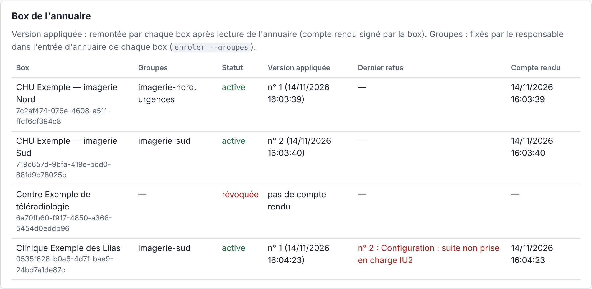
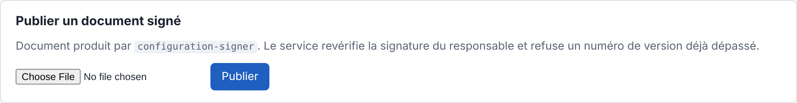
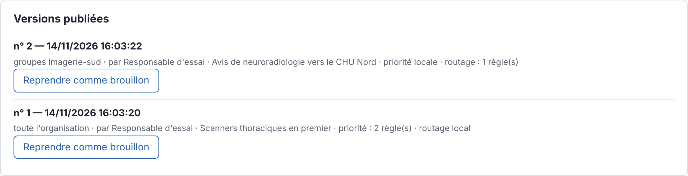

# Guide du responsable de l'organisation

> Pour la personne qui gère le réseau ImagUnity d'une organisation : elle décide quelles box en font partie, et quelles règles communes elles appliquent. Ce guide présente d'abord ImagUnity et ses composants, puis l'annuaire : à quoi il sert, les tâches courantes, et son interface d'administration, partie par partie.
>
> Les exemples et les captures d'écran utilisent une organisation fictive, « chu-exemple », et uniquement des données synthétiques.

**Sommaire**

- [Introduction : ImagUnity en quelques mots](#introduction--imagunity-en-quelques-mots)
- [1. À quoi sert l'annuaire](#1-à-quoi-sert-lannuaire)
- [2. Les tâches courantes du responsable](#2-les-tâches-courantes-du-responsable)
- [3. L'interface d'administration](#3-linterface-dadministration)
- [4. Quand ça ne marche pas](#4-quand-ça-ne-marche-pas)
- [Annexe : les commandes de l'outil du responsable](#annexe--les-commandes-de-loutil-du-responsable)

---

## Introduction : ImagUnity en quelques mots

### Le principe : la poste restante

ImagUnity transporte des examens d'imagerie (DICOM) entre les établissements d'une même organisation, où qu'ils soient, **sans ouvrir aucun port entrant** dans leurs réseaux.

L'établissement qui envoie dépose l'examen, chiffré, sur un relais. L'établissement destinataire vient le chercher quand il est prêt. Chacun n'ouvre que des connexions sortantes, et le relais ne peut pas lire ce qu'il garde : seul le destinataire a la clé.

### Les trois composants


| Composant | Où | Rôle |
|---|---|---|
| **Box** | Une dans chaque établissement, à côté de son PACS | Reçoit les examens du PACS comme une destination DICOM ordinaire. Les empaquette, les chiffre **pour la box destinataire**, puis les dépose sur le relais. Dans l'autre sens, elle télécharge ce qui lui est destiné, vérifie et déchiffre, restitue l'examen à son PACS et envoie un accusé de réception. Une console web montre les transferts en direct. |
| **Relais** | Site central de l'organisation | Une « boîte aux lettres » aveugle. Il garde des morceaux chiffrés et des messages chiffrés le temps que le destinataire les relève, puis les efface. Il n'accepte des dépôts que des box enrôlées dans l'annuaire. |
| **Annuaire** | Site central de l'organisation | La liste **signée** des box de confiance : leur identité, leurs clés, l'adresse où leur écrire. Il diffuse aussi les **règles communes** (priorité des séries, routage) fixées par le responsable. Les box le lisent régulièrement. |

### Le trajet d'un examen

1. Le PACS de l'établissement A envoie l'examen à sa box, comme à n'importe quelle destination DICOM.
2. La **box A** cherche dans l'**annuaire** la box destinataire : ses clés, l'adresse de sa boîte de réception. Elle vérifie que l'entrée est bien signée par le responsable et qu'elle est active.
3. La box A empaquette l'examen, le chiffre pour la box B et le dépose sur le **relais**, puis annonce l'envoi à la box B.
4. La **box B** relève l'annonce et les paquets, vérifie leur empreinte, déchiffre et restitue l'examen à son PACS.
5. La box B renvoie un accusé « restitué » ; le relais efface les morceaux.

L'annuaire intervient à l'étape 2, à chaque échange : une box absente, expirée ou révoquée ne reçoit plus rien et ses messages sont refusés.

### Qui fait quoi

| Rôle | Responsabilités | Documentation |
|---|---|---|
| **Responsable de l'organisation** | Garde la clé de l'organisation. Enrôle, renouvelle et révoque les box. Fixe les règles communes. | Ce guide |
| **Exploitant du site central** | Installe et surveille le relais et l'annuaire, fait les sauvegardes. | [Installation du site central](installation-site-central-rocky10.md) |
| **Exploitant d'une box** | Installe la box de son établissement, la relie à son PACS, transmet sa demande d'enrôlement au responsable. | [Installation d'une box](installation-box-rocky10.md) |

Dans une petite organisation, une même personne peut tenir plusieurs rôles. La clé de l'organisation, elle, ne doit être confiée qu'au responsable.

---

## 1. À quoi sert l'annuaire

### 1.1 Savoir qui est qui

Entre les box d'une organisation, la confiance ne repose ni sur une adresse IP, ni sur un mot de passe partagé, mais sur une **signature**. Chaque box est **enrôlée** par le responsable : il signe une **entrée** qui la décrit, et l'annuaire publie cette entrée. Avant chaque échange, une box vérifie que l'entrée de l'autre box est signée par le responsable, qu'elle est en cours de validité et qu'elle n'est pas révoquée.

### 1.2 Ce que contient une entrée

| Élément | Signification |
|---|---|
| Identifiant | Un numéro unique (UUID), tiré par la box à sa création |
| Nom | Le nom affiché, par exemple « CHU Exemple — imagerie Nord » |
| Clés publiques | La clé de signature de la box (ses messages sont signés) et sa clé de chiffrement (les examens qui lui sont destinés sont chiffrés pour elle) |
| Adresse | L'adresse de sa boîte de réception sur le relais |
| Groupes | Facultatif : des groupes comme `imagerie-nord` ou `urgences`, pour viser plusieurs box à la fois avec les règles communes |
| Validité | Une date de début et une date de fin, 90 jours par défaut |
| Numéro | Augmente à chaque nouvelle émission de l'entrée (renouvellement, changement de groupes, révocation). Seule l'entrée de numéro le plus haut compte. |
| Révocation | Le cas échéant, la date et le motif |

### 1.3 Ce que l'annuaire garantit

L'annuaire **n'est pas de confiance** : il ne fait que publier des documents signés par le responsable, et les box revérifient tout de leur côté. Un annuaire piraté :

- **ne peut pas** ajouter une box, ni changer les clés d'une box : il n'a pas la clé du responsable ;
- **ne peut pas** faire revenir une ancienne entrée, ni une ancienne version des règles : chaque document porte un numéro croissant, et les box refusent tout retour en arrière ;
- **ne peut pas** imposer des règles : les règles communes sont, elles aussi, signées par le responsable ;
- **peut** en revanche cacher des documents : une nouvelle box n'est alors pas vue, ou une révocation n'arrive pas. C'est pourquoi les entrées ont une validité courte, et pourquoi la console de chaque box montre la date de sa dernière lecture réussie de l'annuaire.

### 1.4 La clé du responsable

Toute la confiance du réseau repose sur **la clé de l'organisation**, détenue par le responsable :

- elle est créée une seule fois (§ 2.1) et **reste hors ligne**, sur le poste du responsable, protégée par une phrase de passe ;
- sa partie publique est installée sur le relais, l'annuaire et chaque box ;
- son **empreinte courte**, de la forme `QZYY-WDJT-LDE4-GY7V-5GPV-5RQW`, est communiquée **hors bande** (téléphone, courrier, en personne) aux exploitants, qui la recopient dans la configuration. Une box ou un relais dont l'empreinte ne correspond pas à la clé installée refuse de démarrer : on ne peut pas lui substituer une autre clé à son insu.

Ni l'annuaire ni son interface ne voient jamais la clé privée : tout ce qui est signé l'est sur le poste du responsable, avec l'**outil du responsable**.

> **L'outil du responsable.** Les commandes de ce guide s'écrivent `admin <commande> …`. Sur le site central, le raccourci `admin` est défini dans le [guide d'installation du site central, § 4](installation-site-central-rocky10.md). Sur une station Windows d'essai, c'est `admin.bat` (`deploy/banc-essai/windows`). La phrase de passe de la clé se saisit au clavier, ou passe par la variable `IMAGUNITY_PHRASE_ORGANISATION`. La publication utilise le compte de l'annuaire, par la variable `IMAGUNITY_ANNUAIRE_COMPTE=responsable:<mot de passe>`.

---

## 2. Les tâches courantes du responsable

Ces tâches se font avec l'outil du responsable, en ligne de commande. L'interface d'administration (§ 3) montre leur résultat : les box, leur statut et leurs groupes.

**Gardez les fichiers produits** (demandes, entrées) dans un dossier par box : ils servent pour renouveler ou révoquer.

### 2.1 Créer la clé de l'organisation (une seule fois)

```bash
admin organisation-creer --organisation chu-exemple --cles organisation.json
```

```text
Clé du responsable de « chu-exemple » créée : organisation.json (à garder hors ligne, protégée par phrase de passe)
Clé publique, à installer dans les box : organisation.json.pub.json
Empreinte à communiquer hors bande : QZYY-WDJT-LDE4-GY7V-5GPV-5RQW
```

- `--organisation` : l'identifiant de l'organisation, en minuscules, chiffres et tirets.
- La phrase de passe demandée fait au moins 16 caractères. Notez-la en lieu sûr : sans elle, la clé est inutilisable.
- `organisation.json` est la **clé privée** : à garder hors ligne et à sauvegarder sur un support séparé.
- `organisation.json.pub.json` est la **clé publique** : à remettre à l'exploitant du site central et aux exploitants des box, avec l'empreinte.

### 2.2 Enrôler une box

1. **L'exploitant de la box** télécharge la **demande d'enrôlement** depuis la console de sa box (onglet Annuaire, « Télécharger la demande d'enrôlement ») et vous la transmet, par exemple `demande-nord.json`. Il vous communique aussi, **hors bande**, l'**empreinte de la box** affichée dans sa console.
2. **Vous signez l'entrée** :

   ```bash
   admin enroler --cles organisation.json --demande demande-nord.json --groupes imagerie-nord,urgences \
       --sortie entree-nord.json
   ```

   ```text
   Box « CHU Exemple — imagerie Nord » (7c2af474-076e-4608-a511-ffcf6cf394c8) enrôlée pour 90 jours, n° 1, groupes [imagerie-nord, urgences]
   Vérifiez hors bande l'empreinte de la box avec son installateur : ZJUA-O2FO-TKDQ-FHMF-WSEV-MJIU
   ```

   **Comparez l'empreinte affichée avec celle que l'exploitant vous a donnée.** Si elles diffèrent, la demande n'est pas celle de sa box : ne publiez pas l'entrée.
3. **Vous publiez l'entrée** :

   ```bash
   admin publier --annuaire https://annuaire.exemple.org --entree entree-nord.json
   ```

   ```text
   Entrée publiée dans l'annuaire
   ```

La box apparaît dans l'interface d'administration avec le statut « active ». Les autres box et le relais la voient à leur lecture suivante de l'annuaire (toutes les 5 minutes par défaut). La box crée alors sa boîte de réception sur le relais ; l'exploitant peut ensuite l'appairer avec ses partenaires depuis sa console.

Options de `enroler` :

| Option | Rôle | Par défaut |
|---|---|---|
| `--groupes` | Groupes de la box, séparés par des virgules : minuscules, chiffres et tirets, 16 groupes au plus | aucun |
| `--validite-jours` | Durée de validité de l'entrée | 90 |
| `--serie` | Numéro de l'entrée : 1 à l'enrôlement, puis le numéro suivant à chaque nouvelle émission | 1 |

### 2.3 Renouveler une entrée avant son expiration

Une entrée expirée rend la box injoignable : les autres box refusent de lui envoyer. Renouvelez-la **avant** sa date de fin, en signant la même demande avec le **numéro suivant** :

```bash
admin enroler --cles organisation.json --demande demande-nord.json --groupes imagerie-nord,urgences \
    --serie 2 --sortie entree-nord-2.json
admin publier --annuaire https://annuaire.exemple.org --entree entree-nord-2.json
```

Reprenez les mêmes groupes : une nouvelle entrée remplace entièrement la précédente. Si vous n'avez plus la demande, demandez-en une nouvelle à l'exploitant de la box.

### 2.4 Changer les groupes d'une box

Même démarche que le renouvellement : signer la demande avec le numéro suivant et les nouveaux groupes, puis publier. Les règles communes qui visent ces groupes s'appliquent alors à la box, ou cessent de s'appliquer, à sa lecture suivante de l'annuaire.

### 2.5 Révoquer une box

À faire sans attendre si une box est perdue, volée, compromise, ou si un établissement quitte l'organisation :

```bash
admin revoquer --cles organisation.json --entree entree-nord-2.json --motif "Box volée" --sortie revocation-nord.json
admin publier --annuaire https://annuaire.exemple.org --entree revocation-nord.json
```

- `--entree` : la **dernière** entrée publiée de la box. La révocation reçoit automatiquement le numéro suivant.
- Les autres box voient la révocation à leur lecture suivante de l'annuaire et refusent dès lors tout échange avec cette box. Le relais refuse aussi ses dépôts.
- Dans l'interface, la box passe au statut « révoquée ».

Pour réintégrer plus tard un établissement, mieux vaut repartir d'une **nouvelle** box (nouvelle identité, nouvelle demande d'enrôlement) que réutiliser celle qui a été révoquée.

---

## 3. L'interface d'administration

### 3.1 Se connecter

L'interface est à l'adresse **`https://<annuaire>/admin/`**, par exemple `https://annuaire.exemple.org/admin/`.

- Le navigateur demande le **compte du responsable** sur l'annuaire : l'identifiant (`responsable` par défaut) et le mot de passe fixé à l'installation du site central (`ANNUAIRE_MOT_DE_PASSE`).
- Sur le site central, l'interface n'est ouverte que depuis le **réseau d'administration** (`RESEAU_ADMIN`). Depuis un autre poste, la page est refusée.

L'interface sert à la **configuration centralisée** : voir les box et ce qu'elles appliquent, préparer les règles communes, les essayer, publier une version signée. Elle ne signe rien et n'enrôle aucune box (§ 2).

### 3.2 L'en-tête


| Élément | Signification |
|---|---|
| **Organisation** | L'identifiant de l'organisation, celui de la clé du responsable |
| **Prochaine version** | Le numéro que portera le prochain document de règles préparé. Les numéros sont croissants ; une box n'applique jamais une version plus ancienne que celle qu'elle applique déjà. |
| **Actualiser** | Relit l'état de l'annuaire : statut des box, comptes rendus, versions publiées. La page ne se met pas à jour seule. |

### 3.3 La liste des box



| Colonne | Signification |
|---|---|
| **Box** | Le nom de la box, et son identifiant en dessous |
| **Groupes** | Les groupes fixés dans son entrée (§ 2.4) ; « — » si elle n'en a pas |
| **Statut** | L'état de son entrée, ci-dessous |
| **Version appliquée** | Ce que la box applique, d'après son dernier compte rendu, ci-dessous |
| **Dernier refus** | La dernière version que la box a refusée, et pourquoi ; « — » s'il n'y en a pas |
| **Compte rendu** | La date du dernier compte rendu reçu de la box |

**Statut**

| Statut | Signification | Que faire |
|---|---|---|
| **active** | Entrée valide : la box échange normalement | — |
| **pas encore valide** | La date de début de l'entrée n'est pas atteinte | Attendre, ou vérifier l'heure du poste qui a signé |
| **expirée** | La date de fin est passée : les autres box refusent de lui envoyer | Renouveler l'entrée (§ 2.3) |
| **révoquée** | L'entrée a été révoquée (§ 2.5) | — |

**Version appliquée**

| Affichage | Signification |
|---|---|
| **n° 2 (date)** | La box applique la version 2 des règles communes, depuis cette date |
| **configuration locale** | Aucune version ne vise la box (ou elle est verrouillée sur sa configuration locale) : elle applique ses propres règles |
| **pas de compte rendu** | La box n'a encore jamais rendu compte : elle vient d'être enrôlée, n'a pas encore démarré, ou ne joint pas l'annuaire |

Chaque box envoie un compte rendu **signé par elle-même** à chaque changement, et au moins une fois par heure. Un compte rendu qui date de plusieurs heures signale une box arrêtée, ou qui ne joint plus l'annuaire (§ 4.3).

Dans l'exemple ci-dessus, la « Clinique Exemple des Lilas » applique la version 1 et a **refusé** la version 2 : elle garde la version 1 en attendant (§ 4.3). Le « Centre Exemple de téléradiologie » est révoqué.

### 3.4 Préparer un brouillon de règles


**Box visées**

- **Toute l'organisation** : toutes les box actives, y compris celles enrôlées plus tard.
- **Groupes et box choisis** : cocher un ou plusieurs groupes (le nombre de box actives de chaque groupe est indiqué) et, au besoin, des box une à une. Une box est visée si elle est cochée ou si elle appartient à un groupe coché. Seules les box actives sont proposées.

**Audit**

- **Auteur** : votre nom ; il figure dans le document signé et dans l'historique.
- **Motif** : la raison du changement, en une phrase. Il aide les exploitants des box à comprendre ce qui a changé.

**Priorité des séries (JSON)**

Les séries les plus utiles au diagnostic partent et sont restituées en premier. Une règle donne une priorité de **1 (la plus haute) à 9 (la plus basse)** aux séries qui correspondent ; **la première règle qui correspond s'applique**. `default` est la priorité des séries qu'aucune règle ne couvre (5 si absent).

```json
{ "default": 5,
  "rules": [
    { "name": "scanner-thorax", "priority": 1,
      "and": { "Modality": "CT", "SeriesDescription": "*THORAX*|*POUMON*" } },
    { "name": "localisateurs-en-dernier", "priority": 9,
      "or": { "ImageType": "*LOCALIZER*", "SeriesDescription": "*SCOUT*|*TOPO*" } }
  ] }
```

Ici : les scanners du thorax passent en priorité 1 ; les images de repérage (localisateurs, scouts, topogrammes) passent en dernier ; tout le reste est en priorité 5.

**Routage par champ DICOM (JSON)**

Sur sa **destination de routage** (une destination DICOM réglée par l'exploitant de la box), la box choisit elle-même le destinataire d'après le contenu de l'examen. **La première règle qui correspond s'applique** ; `to` donne le ou les partenaires destinataires, sous **le nom qu'ils portent dans chaque box visée** (le nom donné à l'appairage). Ces partenaires doivent être appairés sur les box visées.

```json
{ "rules": [
    { "name": "irm-cerebrale",
      "and": { "Modality": "MR", "BodyPartExamined": "HEAD|BRAIN" },
      "to": ["box-nord"] }
  ] }
```

Ici : les IRM du crâne sont envoyées au partenaire `box-nord`.

**Laisser un bloc vide** garde la configuration locale des box pour cet aspect : un document peut ne fixer que la priorité, ou que le routage. Il doit fixer au moins l'un des deux.

**Écrire une condition**

| Élément | Exemple | Signification |
|---|---|---|
| `and` | `{ "Modality": "CT", "BodyPartExamined": "CHEST" }` | **Tous** les champs doivent correspondre |
| `or` | `{ "ImageType": "*LOCALIZER*", "SeriesDescription": "*SCOUT*" }` | **Un** champ suffit |
| Valeur exacte | `"CT"` | La valeur du champ est exactement celle-ci (majuscules et minuscules confondues) |
| `*` | `"*THORAX*"` | N'importe quelle suite de caractères |
| `?` | `"CT?"` | Un seul caractère quelconque |
| `\|` | `"HEAD\|BRAIN"` | L'une ou l'autre des valeurs |
| `!` | `"!CT"` | Tout sauf cette valeur |

Les champs se désignent par leur **mot-clé DICOM** : `Modality`, `SeriesDescription`, `BodyPartExamined`, `InstitutionName`, `ImageType`… Un mot-clé mal orthographié est refusé dès la préparation (§ 4.1). Le nom d'une règle (`name`) commence par une lettre ou un chiffre et ne contient que des lettres, chiffres, `.`, `_` et `-`.

**Vérifier et préparer le document**

Le bouton vérifie les règles exactement comme le feront les box, puis prépare le document numéroté :


Cliquez sur **Télécharger le brouillon** (fichier `brouillon-3.json`), puis passez à la signature, sur votre poste.

### 3.5 Signer le document, hors ligne

Sur le poste du responsable, avec la clé de l'organisation :

```bash
admin configuration-signer --cles organisation.json --brouillon brouillon-3.json --sortie configuration-3.json
```

L'outil affiche un résumé (version, box visées, règles), puis **le document exact** à signer, et demande de taper « oui ».

**Relisez le document affiché, pas seulement le résumé.** Le brouillon vient de l'interface, qui pourrait avoir été modifiée par un attaquant : c'est ce que vous lisez ici, sur votre poste, qui sera signé et appliqué par les box. En cas de doute, répondez autre chose que « oui » : rien n'est signé.

### 3.6 Essayer les règles


Avant de signer, on peut essayer le brouillon sur un exemple :

- écrire un **en-tête DICOM fictif**, un champ par ligne (`Modality=CT`), plusieurs valeurs séparées par `\` ;
- cliquer sur **Essayer le brouillon** ;
- le résultat indique la priorité obtenue et la règle qui l'a donnée, et le destinataire choisi par le routage, ou qu'aucune règle ne correspond.

**N'y mettez jamais de données de patient** : un en-tête inventé suffit.

### 3.7 Publier le document signé



Choisissez le fichier signé (`configuration-3.json`) et cliquez sur **Publier**. L'annuaire revérifie la signature et refuse un numéro de version déjà dépassé. Équivalent en ligne de commande :

```bash
admin configuration-publier --annuaire https://annuaire.exemple.org --configuration configuration-3.json
```

Les box visées lisent le document à leur lecture suivante de l'annuaire, le vérifient et l'appliquent **sans redémarrer**. Après quelques minutes, cliquez sur **Actualiser** : la colonne « Version appliquée » montre le nouveau numéro pour chaque box qui l'a appliqué, ou la raison d'un refus.

### 3.8 Les versions publiées



Chaque version publiée apparaît avec son numéro, sa date, les box visées, l'auteur, le motif et le nombre de règles (« priorité locale » ou « routage local » quand le bloc était vide).

**Reprendre comme brouillon** recopie les règles et les box visées de cette version dans le brouillon, pour la modifier ou la republier. Le document préparé reçoit alors un **nouveau numéro** : on ne revient pas en arrière en republiant un ancien numéro, on publie une nouvelle version qui reprend d'anciennes règles.

---

## 4. Quand ça ne marche pas

Les erreurs s'affichent dans un bandeau en haut de la page :


### 4.1 Le brouillon est refusé

| Message | Cause | Solution |
|---|---|---|
| « Brouillon refusé : Règle invalide : … mot-clé DICOM inconnu « Modalite » » | Mot-clé DICOM mal orthographié | Corriger le mot-clé (`Modality`) |
| « Brouillon refusé : Règle invalide : … sans priorité » | Règle de priorité sans champ `priority` | Ajouter une priorité de 1 à 9 |
| « … aucune box visée » | « Groupes et box choisis » sans aucune case cochée | Cocher au moins un groupe ou une box, ou choisir « Toute l'organisation » |
| « Configuration vide : ni priorité ni routage » | Les deux blocs sont vides | Remplir au moins un bloc |
| « Configuration : priorité par défaut hors de 1 à 9 » | `default` invalide | Mettre une valeur de 1 à 9 |
| « Priorité : JSON invalide (…) » ou « Routage : JSON invalide (…) » | Virgule, guillemet ou accolade manquante | Corriger la syntaxe du bloc indiqué |

### 4.2 La publication est refusée

| Message | Cause | Solution |
|---|---|---|
| « Configuration n° 3 refusée : la dernière publiée est la n° 4 » | Une version plus récente a été publiée entre-temps | Reprendre la dernière version comme brouillon, refaire les modifications, signer et publier le nouveau numéro |
| « Configuration non signée par le responsable de l'organisation » | Le fichier n'est pas signé par la clé de l'organisation, ou a été modifié après la signature | Signer le brouillon avec `configuration-signer`, sans retoucher le fichier signé |
| « Retour en arrière refusé pour la box … » (entrée) | L'entrée publiée porte un numéro plus petit que la dernière entrée de la box | Signer avec `--serie` égal au dernier numéro + 1 |
| « Une autre entrée n° 2 est déjà publiée pour la box … » | Deux entrées différentes signées avec le même numéro | Signer avec le numéro suivant |
| « Entrée non signée par le responsable de l'organisation » | Entrée signée avec une autre clé | Vérifier qu'on utilise bien `organisation.json` de cette organisation |
| « Nom de box trop long » | Nom de plus de 256 caractères dans la demande | Demander une nouvelle demande d'enrôlement avec un nom plus court |
| HTTP 401 | Mauvais compte ou mot de passe de l'annuaire | Vérifier `IMAGUNITY_ANNUAIRE_COMPTE`, ou le compte saisi dans le navigateur |

### 4.3 Une box ne suit pas

| Ce que montre la liste | Cause probable | Que faire |
|---|---|---|
| « Dernier refus » rempli, version appliquée inchangée | La box ne peut pas appliquer la version, souvent parce que son logiciel est plus ancien que l'annuaire. Elle garde les règles qu'elle appliquait. | Lire le motif ; faire mettre la box à jour par son exploitant. Elle appliquera la version à sa lecture suivante. |
| « Compte rendu » ancien de plusieurs heures | Box arrêtée, ou qui ne joint plus l'annuaire | Prévenir l'exploitant de la box : sa console indique la date de sa dernière lecture réussie de l'annuaire |
| « pas de compte rendu » longtemps après l'enrôlement | Box pas encore démarrée, ou mauvaise empreinte du responsable dans sa configuration (elle refuse alors de démarrer) | Vérifier avec l'exploitant que la box tourne et que l'empreinte recopiée est la bonne |
| « configuration locale » alors qu'une version la vise | Box verrouillée sur sa configuration locale par son exploitant, ou groupes de son entrée différents de ceux visés | Vérifier les groupes dans la liste ; demander à l'exploitant si la box est verrouillée |
| Statut « expirée » | Entrée non renouvelée à temps | Renouveler (§ 2.3) |

---

## Annexe : les commandes de l'outil du responsable

| Commande | Rôle |
|---|---|
| `organisation-creer --organisation <id> --cles <fichier>` | Crée la clé de l'organisation et affiche son empreinte (§ 2.1) |
| `empreinte --cle-publique <fichier>` | Affiche l'empreinte d'une clé publique d'organisation |
| `enroler --cles <clé> --demande <fichier> [--groupes …] [--validite-jours 90] [--serie 1] --sortie <fichier>` | Signe l'entrée d'une box (§ 2.2 à 2.4) |
| `revoquer --cles <clé> --entree <fichier> --motif <texte> --sortie <fichier>` | Signe la révocation d'une box (§ 2.5) |
| `verifier --cle-publique <fichier> --entree <fichier>` | Vérifie une entrée signée et affiche son état |
| `publier --annuaire <url> --entree <fichier>` | Publie une entrée ou une révocation dans l'annuaire |
| `configuration-signer --cles <clé> --brouillon <fichier> --sortie <fichier>` | Signe un brouillon de règles, après relecture (§ 3.5) |
| `configuration-publier --annuaire <url> --configuration <fichier>` | Publie un document de règles signé (§ 3.7) |
| `proteger --cles <fichier>` | Protège par phrase de passe une clé créée sans |

Pour aller plus loin : [annuaire signé](../reference/annuaire-signe.md) (formats et vérifications), [configuration centralisée](../reference/configuration-centralisee.md) (fonctionnement côté box), [priorité des séries](../reference/priorite-dicom.md), [routage par champ DICOM](../reference/routage-dicom.md).
