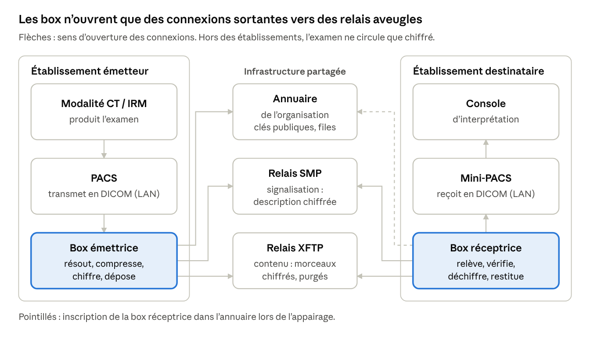

# ImagUnity — Note d'architecture

> **Document historique** (9 novembre 2026), à l'origine du projet. Il décrit l'architecture de départ, sur le transport SimpleX (relais SMP et XFTP), depuis remplacé par IU-T ([spécification](../reference/specification-protocole.md)). Reprise en Markdown de l'original Word, conservé à côté : [`ImagUnity — Note d'architecture.docx`](ImagUnity%20—%20Note%20d'architecture.docx).

## Contexte et intention

ImagUnity est une box qui transporte des examens d'imagerie DICOM entre deux établissements partenaires, où qu'ils soient dans le monde, sans ouvrir aucun port entrant. Une box s'installe de chaque côté, et un relais placé entre les deux ne voit passer que des données chiffrées.

Le cas d'usage fondateur est simple. Un hôpital en Afrique dispose d'un scanner, mais le service spécialiste consulté en urgence se trouve en France. Aujourd'hui, transmettre l'examen suppose un VPN négocié entre deux DSI, des ports ouverts ou un service tiers auquel il faut faire confiance. Avec ImagUnity, l'examen part dès que les deux box sont installées.

L'imagerie concentre trois difficultés que les outils d'échange généralistes traitent mal :

- **DICOM n'est ni sécurisé ni conçu pour le transfert distant.** C'est un protocole de réseau local, qui suppose une connectivité directe entre les nœuds.

- **Les examens sont volumineux**, de quelques centaines de Mo à plusieurs Go pour un scanner ou une IRM, souvent sur des liaisons lentes ou instables.

- **Les réseaux sont hétérogènes** : pare-feu, NAT, politiques de sécurité qui interdisent toute ouverture entrante.

Le périmètre est volontairement étroit. ImagUnity transporte les examens et rien d'autre : l'interprétation et le retour de l'avis passent par un autre canal. Dans un premier temps, le réseau est fermé : les acteurs se connaissent et échangent dans le cadre d'une organisation de prise en charge.

Les briques propres à l'imagerie sont maîtrisées depuis quinze ans de développement de box : intégration aux PACS, routage DICOM, compression, chiffrement, découpage des examens. Ce qui change avec ImagUnity, c'est le transport : plus simple, plus sûr et plus robuste, parce que le système est fermé par construction.

## Le principe : la poste restante

L'émetteur dépose l'examen chiffré sur un relais, et le destinataire vient le chercher quand il est prêt. Les deux box ouvrent elles-mêmes leurs connexions vers le relais : aucune n'a besoin d'être joignable depuis l'extérieur, et le dispositif fonctionne derrière n'importe quel pare-feu qui autorise une connexion TLS sortante.

Le relais est aveugle par construction. Il stocke des morceaux chiffrés dont il n'a pas les clés, ne connaît ni l'émetteur ni le destinataire, et efface chaque morceau une fois retiré. La sécurité ne repose donc pas sur la confiance accordée à son opérateur, mais sur la cryptographie de bout en bout entre les deux box.

Ce modèle a un autre avantage pour les liaisons difficiles : émetteur et destinataire n'ont pas besoin d'être connectés en même temps. Une coupure réseau d'un côté retarde le transfert sans l'interrompre.

## Architecture générale

architecture ImagUnity · 2 box, 2 relais, 1 annuaire

Le dispositif compte trois éléments : une box dans chaque établissement, des relais SMP et XFTP qui ne voient que des données chiffrées, et un annuaire propre à l'organisation, distinct des relais. Toutes les connexions partent des box : l'émettrice consulte l'annuaire et dépose sur les relais, la réceptrice vient relever ce qui l'attend.

## Protocoles : SMP pour la signalisation, XFTP pour le contenu

ImagUnity s'appuie sur deux protocoles de l'écosystème SimpleX, conçus selon la même philosophie : relais aveugles, aucune identité côté serveur, connexions initiées par les clients.

**SMP (SimpleX Messaging Protocol)** gère des files de messages unidirectionnelles. L'expéditeur dépose un message chiffré dans la file, le destinataire le relève et l'acquitte, puis le message est supprimé. SMP transporte de petits messages, d'environ 16 Ko : il sert ici à la signalisation, c'est-à-dire à annoncer qu'un examen attend et comment le récupérer.

**XFTP (SimpleX File Transfer Protocol)** transporte le contenu volumineux. L'émetteur découpe le fichier chiffré en morceaux de taille fixe et les dépose sur des relais qu'il choisit, éventuellement auto-hébergés. Chaque destinataire dispose de sa propre clé et de son propre identifiant pour autoriser le retrait de chaque morceau. L'émetteur rassemble ensuite les adresses, les clés d'accès et les empreintes de tous les morceaux, ainsi que la clé de chiffrement du fichier, dans une « description de fichier » transmise au destinataire par SMP. Le protocole prévoit aussi la redondance, un même morceau pouvant être déposé sur plusieurs relais.

Déroulé d'un envoi :

1.  Le PACS envoie l'examen à la box émettrice, comme à n'importe quelle destination DICOM du réseau local.

2.  La box identifie le destinataire, soit par la destination DICOM (AET, port) sur laquelle l'examen lui a été envoyé, soit par un champ DICOM de l'examen. Elle obtient ensuite dans l'annuaire sa clé publique et l'adresse de sa file SMP.

3.  Elle compresse l'examen sans perte, le chiffre pour le destinataire et le découpe en blocs, en adaptant ces traitements à la qualité du réseau, puis dépose les morceaux sur un ou plusieurs relais XFTP.

4.  Elle envoie la description du fichier dans la file SMP du destinataire.

5.  La box réceptrice relève le message, télécharge les morceaux, vérifie leurs empreintes, puis déchiffre et décompresse l'examen.

6.  Elle transmet l'examen au mini-PACS et renvoie un accusé de bout en bout à l'émetteur, par une file SMP de retour.

7.  Les relais suppriment les morceaux après leur retrait, ou à l'expiration d'une durée de séjour maximale.

Le chiffrement de l'examen avec la clé publique du destinataire, tirée de l'annuaire, ajoute une couche applicative au chiffrement natif de XFTP. Cette défense en profondeur garantit qu'ImagUnity reste maître de sa cryptographie, indépendamment de l'implémentation SimpleX retenue.

## Habilitation et confiance

Le relais ne sait jamais qui est habilité : il vérifie seulement que celui qui demande un morceau détient la bonne clé. C'est un modèle par capacité, et non par identité.

**Au niveau du relais, l'autorisation est purement cryptographique.** Lors du dépôt, l'émetteur enregistre pour chaque morceau une clé publique propre au destinataire, et le relais lui renvoie un identifiant de retrait opaque. Pour télécharger, le destinataire présente cet identifiant et signe sa requête avec la clé privée correspondante. Sans ces deux éléments, la requête est refusée ; et même un morceau obtenu frauduleusement resterait chiffré.

**L'habilitation se décide chez l'émetteur, au moment de l'envoi.** Seul le destinataire désigné par l'annuaire reçoit, dans sa file SMP, la description du fichier qui contient les clés de retrait. La question « qui est habilité ? » devient donc : qui l'annuaire désigne-t-il comme destinataire légitime ? C'est une question de gouvernance plus que de technique.

**L'organisation de prise en charge est l'unité de confiance.** Les box y entrent par un appairage explicite, validé par un responsable de l'organisation qui peut aussi en retirer une. Chaque organisation tient ainsi un annuaire léger, distinct des relais qui stockent les fichiers. Une même box peut appartenir à plusieurs organisations.

**Le dépôt peut être réservé aux box enrôlées**, par un secret ou un certificat client, pour que les relais ne servent pas à n'importe qui. En revanche, un contrôle d'identité au moment du retrait est à proscrire : il obligerait le relais à savoir qui récupère quoi.

Deux conséquences de gouvernance en découlent :

- Le destinataire, au sens cryptographique, est une box, donc un établissement ou un service. L'habilitation des personnes reste locale, dans les droits d'accès du mini-PACS ou de la console.

- La révocation se joue dans l'annuaire. Retirer une box empêche tout nouvel envoi vers elle, mais les paquets déjà émis restent récupérables jusqu'à leur expiration, d'où l'intérêt d'une durée de séjour courte.

## La box : une appliance de sécurité

La box porte toute la sécurité du dispositif et doit pourtant s'installer sans compétence informatique sur place. Ces deux exigences se concilient si les clés naissent dans la box et n'en sortent jamais.

**Gestion des clés.** La box génère elle-même sa paire de clés d'identité dans un composant sécurisé (TPM ou élément sécurisé), et seule la clé publique est communiquée lors de l'appairage. Les clés propres à chaque échange, clés de retrait XFTP et clés des files SMP, sont éphémères et renouvelées en permanence. SimpleX applique déjà ce principe avec son mécanisme de *double ratchet*.

**Remplacement plutôt que restauration.** Si une box tombe en panne, on ne restaure pas ses clés : on enrôle une nouvelle box et on retire l'ancienne. Il n'existe donc aucune sauvegarde de clé à protéger, ce qui supprime toute une catégorie de risques.

**Installation en trois gestes :**

1.  Brancher la box sur le réseau local ; elle n'a besoin que d'une connexion TLS sortante.

2.  La déclarer comme destination DICOM dans le PACS.

3.  L'appairer à l'organisation, en scannant un QR code ou en saisissant un code court.

**Exploitation à distance.** Les mises à jour arrivent signées par le même canal sortant. La supervision se limite à des indicateurs techniques, comme l'espace disque ou l'état des transferts, qui ne révèlent rien des examens. Dans un établissement éloigné, la box doit aussi supporter les coupures de courant et reprendre les transferts là où ils se sont arrêtés.

## Surface d'attaque résiduelle

Un système fermé par construction supprime l'essentiel de la surface d'attaque classique : aucun port entrant, aucun service exposé sur Internet, des relais qui ne détiennent aucune clé. Le risque ne disparaît pas pour autant ; il se concentre sur quelques points, qu'il faut protéger en priorité.

| Point d'attaque                | Risque                                                         | Parade                                                                                                     |
|--------------------------------|----------------------------------------------------------------|------------------------------------------------------------------------------------------------------------|
| Annuaire                       | Une clé publique substituée détourne les examens vers un tiers | Entrées signées par le responsable de l'organisation, vérification de l'empreinte hors bande à l'appairage |
| Canal de mise à jour           | Un code malveillant signé atteint toutes les box à la fois     | Clé de signature hors ligne, double signature, mises à jour vérifiables                                    |
| Box volée ou compromise        | Lecture des examens reçus, envois frauduleux                   | Clés dans un composant sécurisé, révocation dans l'annuaire, durée de séjour courte                        |
| Interface DICOM locale         | Toute machine du réseau local peut pousser vers la box         | Liste des AET autorisés, filtrage réseau                                                                   |
| Routage par champ DICOM        | Un champ erroné ou forgé envoie l'examen au mauvais partenaire | Seules les destinations appairées sont admises, règles de routage explicites                               |
| Fichiers reçus d'un partenaire | Un DICOM malformé exploite une faille du mini-PACS             | Validation et normalisation par la box réceptrice                                                          |
| Relais                         | Déni de service, suppression de morceaux, analyse de trafic    | Redondance entre relais, dépôt réservé aux box enrôlées, relais auto-hébergés                              |

L'annuaire et le canal de mise à jour sont les deux points les plus critiques : chacun, compromis, ouvre l'accès à l'ensemble du réseau plutôt qu'à une seule box. Il faut aussi noter que le chiffrement de bout en bout ne masque pas les métadonnées réseau : un observateur peut voir qu'un établissement échange avec un relais, à quel moment et en quel volume. Enfin, des données de santé chiffrées peuvent être enregistrées aujourd'hui pour être déchiffrées plus tard ; le choix d'algorithmes résistants au calcul quantique, que SimpleX a commencé à intégrer, mérite d'être examiné dès la conception.

## Intégration DICOM et intégrité des examens

On ne fait pas voyager DICOM, on transporte des objets DICOM. DICOM reste sur le réseau local de chaque établissement, là où il est acceptable, et la box est la frontière qui le convertit en paquets chiffrés puis le restitue de l'autre côté.

**Côté émetteur**, la box est une destination DICOM ordinaire du PACS (C-STORE, ou STOW-RS si le PACS parle DICOMweb). **Côté destinataire**, elle pousse l'examen restitué vers le mini-PACS par le même mécanisme. Aucun des deux PACS n'a besoin de connaître ImagUnity.

**L'intégrité doit être vérifiable de bout en bout :**

- les identifiants DICOM (UID d'étude, de série et d'instance) sont conservés tels quels ;

- la compression est sans perte, pour que l'intégrité diagnostique ne soit jamais discutable ;

- chaque instance porte une empreinte, contrôlée à l'arrivée.

L'accusé renvoyé à l'émetteur atteste alors que l'examen est arrivé complet et identique, et pas seulement qu'il a été téléchargé.

**Le routage vers le destinataire se fait de deux façons.** Soit une destination DICOM (AET, port) est créée pour chaque destinataire et paramétrée sur le PACS ou sur une station d'imagerie locale : envoyer à cette destination, c'est désigner le destinataire. Soit la box lit le destinataire dans un champ DICOM de l'examen. Dans les deux cas, seules les destinations appairées au sein de l'organisation sont admises.

**L'optimisation selon le réseau est l'une des valeurs ajoutées de la box.** Elle ajuste la compression, le chiffrement et la taille des blocs à la qualité de la liaison, et peut envoyer en priorité les séries utiles au diagnostic. Ce savoir-faire existe déjà ; ImagUnity lui donne un transport adapté.

**L'identité du patient** n'est pas partagée entre pays, faute d'identifiant commun. Le mini-PACS récepteur doit donc traiter ces examens comme des dossiers externes, sans rapprochement automatique avec des patients locaux.

## Positionnement par rapport à DRIMbox

ImagUnity ne concurrence pas DRIMbox : il couvre un besoin que le réseau DRIM-M ne vise pas. DRIM-M organise, en France, la consultation à la demande de l'historique d'imagerie d'un patient identifié ; ImagUnity pousse un examen précis vers un partenaire connu, y compris hors de France.

Dans DRIM-M, chaque structure d'imagerie connecte son PACS au réseau par une DRIMbox. La fonction Source construit un pointeur (manifeste KOS) pour chaque examen et l'envoie au DMP ; la fonction Consommation récupère ces pointeurs pour un patient identifié, puis télécharge les images auprès de la DRIMbox Source. L'Espace de confiance géré par l'ANS fournit un registre national qui attribue un nom de domaine à chaque DRIMbox, une liste blanche signée et une météo des DRIMbox ([ANS, Espace de confiance DRIM-M](https://esante.gouv.fr/doctrine/DRIM-M)).

|                  | DRIM-M / DRIMbox                                                     | ImagUnity                                                         |
|------------------|----------------------------------------------------------------------|-------------------------------------------------------------------|
| Finalité         | Consulter l'antériorité des examens d'un patient                     | Transmettre un examen précis, souvent en urgence                  |
| Initiative       | Le consommateur va chercher (pull)                                   | L'émetteur envoie (push en poste restante)                        |
| Indexation       | Pointeurs KOS dans le DMP                                            | Aucune : la description du fichier va directement au destinataire |
| Identité patient | Patient identifié et qualifié                                        | Non requise, dossiers externes à l'arrivée                        |
| Périmètre        | National, DRIMbox référencées Ségur                                  | Organisation de prise en charge, international                    |
| Confiance        | Espace de confiance national géré par l'ANS                          | Appairage au sein de l'organisation                               |
| Flux réseau      | La DRIMbox Source répond aux DRIMbox Conso et expose une visionneuse | Connexions sortantes uniquement, vers des relais aveugles         |

L'expérience acquise sur DRIMbox est directement réutilisable : intégration au PACS et au RIS, passerelle DICOM, gestion des volumes et des syntaxes de transfert. À plus long terme, ImagUnity pourrait aussi servir de prolongement international au réseau DRIM-M, une piste à discuter.

## Cadre réglementaire

Les relais ne conservent pas les données, ils les font transiter : ils ne relèvent donc pas de l'hébergement de données de santé (HDS). Pour que cet argument reste solide, la durée de séjour des morceaux sur un relais doit être courte et bornée, avec une purge automatique après retrait ou expiration.

Les établissements, eux, restent soumis à leurs obligations habituelles. Le destinataire français qui reçoit, conserve et interprète l'examen traite des données de santé au sens du RGPD.

L'usage international soulève des questions qui relèvent de la convention de partenariat plutôt que de la technique :

- la loi de protection des données du pays émetteur, qui peut soumettre l'export de données de santé à une autorisation préalable ;

- la responsabilité médicale d'un avis rendu en France pour un patient soigné à l'étranger ;

- l'information et le consentement du patient.

Enfin, la box ne fait que transporter, stocker temporairement et restituer les examens sans les modifier. Elle ne devrait donc pas relever du statut de dispositif médical, un point à confirmer.

## Preuve de concept

La preuve de concept doit démontrer une seule chose : un examen part d'un PACS, traverse des relais aveugles sans aucun port entrant, et arrive intact dans un autre PACS, y compris sur une liaison dégradée. Tout le reste attend le pilote.

### Composants minimaux

| Composant                    | Rôle dans la preuve de concept                                                                                         | Développer ou réutiliser                                                              |
|------------------------------|------------------------------------------------------------------------------------------------------------------------|---------------------------------------------------------------------------------------|
| Relais SMP et XFTP           | Files de signalisation et stockage des morceaux chiffrés                                                               | Réutiliser : serveurs smp-server et xftp-server de SimpleX, sur une machine virtuelle |
| Client SimpleX de chaque box | Appairage, signalisation SMP, envoi et réception des fichiers par XFTP                                                 | Réutiliser : simplex-chat en ligne de commande, piloté par son API WebSocket          |
| Entrée DICOM                 | Recevoir l'examen du PACS (C-STORE)                                                                                    | Réutiliser une bibliothèque DICOM ou le code des box existantes                       |
| Empaquetage                  | Regrouper les instances d'une étude, compresser sans perte, calculer une empreinte par instance, produire un manifeste | Développer                                                                            |
| Orchestrateur                | Associer l'AET appelé à un contact appairé, déclencher l'envoi, suivre l'état du transfert                             | Développer                                                                            |
| Restitution                  | Vérifier les empreintes, dépaqueter, pousser l'examen vers le PACS destinataire (C-STORE)                              | Développer, sur une bibliothèque DICOM                                                |
| Accusé de bout en bout       | Message de retour attestant que l'examen est arrivé complet et identique                                               | Développer                                                                            |
| PACS de test                 | Émetteur et destinataire                                                                                               | Réutiliser : deux instances Orthanc                                                   |

Le seul code nouveau est une couche d'orchestration fine entre une bibliothèque DICOM et le client SimpleX. Le même logiciel joue le rôle d'émetteur ou de récepteur selon sa configuration.

### Simplifications assumées

- **Pas d'annuaire** : l'appairage des deux box par lien d'invitation SimpleX, et un fichier de configuration qui associe chaque AET à un contact, en tiennent lieu.

- **Routage par destination DICOM (AET) uniquement** ; le routage par champ DICOM viendra ensuite.

- **Chiffrement natif de SimpleX seul** ; la couche applicative avec la clé publique du destinataire arrivera avec l'annuaire.

- **Ni composant sécurisé, ni mise à jour signée, ni interface d'administration.**

- **Compression générique sans perte**, sans adaptation à la qualité du réseau.

- **Données de test uniquement**, anonymisées ou issues de jeux publics, aucun patient réel.

### Scénarios de test

L'environnement tient en une machine virtuelle pour les relais, deux machines ou conteneurs pour les box et les PACS, et un émulateur réseau pour dégrader la liaison.

| Test                                                                        | Ce qu'il prouve                                                                  |
|-----------------------------------------------------------------------------|----------------------------------------------------------------------------------|
| Envoi d'un examen du PACS A vers le PACS B                                  | La chaîne fonctionne de bout en bout                                             |
| Comparaison des UID et des empreintes à l'arrivée                           | L'examen arrive complet et identique                                             |
| Box derrière un pare-feu qui bloque tout trafic entrant, avec scan de ports | Aucun port entrant n'est nécessaire                                              |
| Inspection du stockage des relais                                           | Les relais ne détiennent que des données chiffrées                               |
| Liaison bridée en débit, avec latence et pertes de paquets                  | Le transfert reste exploitable sur une liaison dégradée ; les temps sont mesurés |
| Coupure réseau au milieu d'un transfert                                     | Le transfert reprend sans tout recommencer                                       |
| Box réceptrice éteinte pendant l'envoi, rallumée plus tard                  | La poste restante fonctionne de manière asynchrone                               |
| Examen de plusieurs Go                                                      | Les limites de taille et le besoin éventuel d'un découpage par série             |

## Licence : un transport ouvert, une box propriétaire

La box doit rester propriétaire, tandis que le transport peut rester ouvert. Cette séparation est compatible avec la licence des composants SimpleX, à condition de bien tracer la frontière entre les deux.

**Ce que dit l'AGPL-3.0.** simplexmq et simplex-chat sont publiés sous cette licence ([simplexmq](https://github.com/simplex-chat/simplexmq)). Un logiciel qui incorpore du code AGPL, par exemple comme bibliothèque, devient une œuvre dérivée à distribuer sous AGPL avec son code source. Une box remise à un établissement est une distribution : si son logiciel était lié à simplexmq, l'établissement pourrait exiger le code de toute la box.

**L'AGPL protège du code, pas un protocole.** SMP et XFTP sont des spécifications publiques ; seules leurs implémentations par SimpleX sont sous AGPL. La clause propre aux services réseau ne vise que les versions modifiées : exploiter les relais sans modification n'impose rien de plus.

**Trois voies sont possibles :**

1.  **Le transport comme programme séparé.** La box fait tourner le client SimpleX non modifié comme un processus distinct, et le logiciel propriétaire lui parle par son API WebSocket, comme dans la preuve de concept. Seul le composant SimpleX reste sous AGPL, et les obligations se limitent à fournir sa licence et son code source. Conditions : aucun lien en bibliothèque, aucune modification non publiée, une frontière claire entre les deux programmes.

2.  **Une réimplémentation propriétaire** de SMP et XFTP à partir des spécifications, sans reprendre le code existant. La box est entièrement fermée et reste compatible avec les relais SimpleX, au prix d'un développement plus lourd.

3.  **Une licence commerciale** négociée avec l'éditeur de SimpleX, au prix d'une dépendance.

**Où se trouve le secret industriel.** L'intelligence de la box doit vivre dans le code propriétaire : préparation des paquets, découpage par série, compression, taille des blocs, ordre d'envoi et parallélisme, adaptés à la qualité du réseau. Si cette optimisation exigeait de modifier le client XFTP lui-même, ces modifications devraient être publiées dans la première voie. La box doit donc préparer ses paquets avant de les confier au transport.

Cette séparation a aussi une valeur commerciale : un transport ouvert, que tout DSI peut auditer, renforce l'argument de la sécurité par construction, pendant que le savoir-faire qui fait la valeur de la box reste protégé. La frontière entre programmes séparés et œuvre dérivée s'apprécie au cas par cas : une validation par un avocat spécialisé en propriété intellectuelle et en logiciels libres est indispensable avant la commercialisation, mais pas pour la preuve de concept.

## Questions ouvertes et proposition

L'architecture est stabilisée dans ses principes ; les choix suivants sont à faire ensemble.

- **Réutiliser ou réimplémenter SimpleX ?** La bibliothèque de référence (simplexmq) implémente SMP et XFTP, mais sa licence AGPL-3.0 pèse sur un produit non open source (voir la preuve de concept). Le choix est à faire après les tests.

- **Taille des examens.** Lors de son intégration, l'implémentation de référence de XFTP limitait la taille des fichiers à 1 Go ([simplexmq v5.0.0](https://github.com/simplex-chat/simplexmq/releases/tag/v5.0.0)). Un découpage par série contournerait cette limite.

- **Qui opère les relais ?** Un relais par organisation, un relais régional, ou des relais auto-hébergés par les établissements eux-mêmes.

- **Gouvernance de l'annuaire** : format, procédure d'appairage, rôle du responsable de l'organisation, révocation.

- **Liaisons à faible débit** : priorisation des séries, redondance entre relais, placement d'un relais proche de l'émetteur.

- **Matériel de la box** : composant sécurisé, autonomie en cas de coupure, procédure de remplacement.

- **Articulation avec DRIM-M**, à moyen terme.

**Proposition :** mener la preuve de concept décrite plus haut sur données de test, puis l'éprouver sur un cas d'usage réel entre deux établissements partenaires.

### Sources

- [ANS — Espace de confiance DRIM-M](https://esante.gouv.fr/doctrine/DRIM-M)

- [SimpleX — SimpleX File Transfer Protocol (annonce, mars 2023)](https://www.github.com/simplex-chat/simplex-chat/blob/stable/blog/20230301-simplex-file-transfer-protocol.md)

- [SimpleX — RFC du protocole XFTP](https://github.com/simplex-chat/simplexmq/pull/582/files)

- [simplexmq — notes de version 5.0.0](https://github.com/simplex-chat/simplexmq/releases/tag/v5.0.0)
