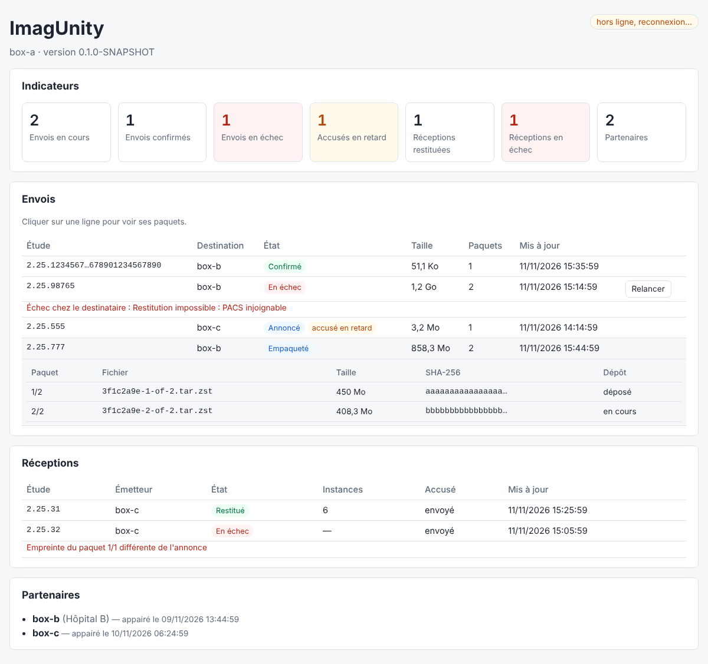

# Phase 7 — API et console React

> Objectif : suivre les transferts de la box depuis un navigateur, en direct, et relancer un transfert en échec.
> Statut : **fait**. Console en lecture seule, plus la relance. La configuration (AET, routes, appairage) reste dans `application.yml` et l'API d'appairage.



## 1. API REST

| Requête | Réponse |
|---|---|
| `GET /api/v1/box` | nom et version de la box |
| `GET /api/v1/overview` | transferts envoyés et reçus par état, accusés en retard, nombre de partenaires |
| `GET /api/v1/transfers?limit=50` | transferts envoyés, du plus récemment modifié au plus ancien (`limit` de 1 à 500) |
| `GET /api/v1/transfers/{id}` | un transfert envoyé et ses paquets (nom, taille, SHA-256, confié au transport, déposé) ; 404 si inconnu |
| `POST /api/v1/transfers/{id}/retry` | relance d'un transfert en échec (§ 3) ; 404 si inconnu, 409 si impossible, avec la raison |
| `GET /api/v1/inbound-transfers?limit=50` | transferts reçus : émetteur, état, instances restituées, accusé envoyé |
| `GET /api/v1/peers` | partenaires appairés (phase 4) |
| `GET /api/v1/events` | flux SSE (§ 2) |

Les erreurs suivent le format `ProblemDetail` (RFC 9457) ; la console affiche leur `detail`.

**Ce que l'API n'expose pas.** Aucune donnée démographique du patient : seulement des UID DICOM, des tailles, des états et des causes d'échec techniques. Les chemins de fichiers de la box ne sortent pas (nom du paquet seulement). L'API n'a **pas d'authentification** dans la preuve de concept : elle écoute sur le réseau local de la box et doit y rester ; l'authentification des opérateurs est à prévoir pour le pilote.

## 2. Mises à jour en direct (SSE)

Les dépôts de transferts sont enveloppés par des décorateurs (`NotifyingTransferRepository`, `NotifyingInboundRepository`) : chaque création ou changement publie un événement aux consoles connectées.

```
event: ready       à l'ouverture du flux
event: transfer    data: <transfert envoyé, même format que GET /api/v1/transfers>
event: inbound     data: <transfert reçu, même format que GET /api/v1/inbound-transfers>
```

- Les envois partent d'un **fil dédié** : une console lente ne ralentit jamais l'orchestrateur.
- Un flux fermé côté navigateur est oublié au premier envoi qui échoue ; chaque flux est fermé au bout de 30 min et le navigateur se reconnecte (`EventSource`).
- À l'arrêt de la box, les flux sont fermés **avant** l'arrêt du serveur web, sans quoi l'arrêt gracieux attendrait 30 s des requêtes qui ne finissent jamais.
- La console rafraîchit ses listes à chaque événement, et rafraîchit tout après une reconnexion (événements manqués). Elle interroge aussi l'API toutes les 30 s, par sécurité.

## 3. Relance d'un transfert en échec

| Côté | Comportement |
|---|---|
| Émetteur | Seul un transfert `FAILED` **déjà empaqueté** se relance : ses paquets, gardés dans `outbox/<transfert>`, sont confiés de nouveau au transport (`FAILED → PACKAGED`), puis le transfert est annoncé de nouveau, sous le **même identifiant**. Refus (409) si le transfert n'est pas en échec, a échoué avant l'empaquetage, ou si un paquet a disparu : il faut alors renvoyer l'étude depuis le PACS. |
| Destinataire | Une nouvelle annonce d'un transfert `FAILED`, pour le même groupe de paquets, ouvre une nouvelle tentative (`FAILED → ANNOUNCED`). Les paquets d'une tentative ratée sont **écartés dès l'échec** (état `FAILED`, fichier supprimé) : la relance repart de paquets neufs et ne peut pas réutiliser un paquet altéré. Une nouvelle annonce d'un transfert déjà `RESTORED` ne fait que renvoyer l'accusé, et ses paquets ne sont pas retéléchargés. |

La relance s'exécute sur le fil de l'orchestrateur ; l'API attend son résultat jusqu'à 30 s (503 au-delà, la relance ayant lieu dès que l'orchestrateur est libre).

## 4. Console

React 19 + TanStack Query, sans autre dépendance. Une page :

- **Indicateurs** : envois en cours, confirmés, en échec ; accusés en retard ; réceptions restituées et en échec ; partenaires. Les tuiles d'alerte se colorent quand elles ne sont pas à zéro.
- **Envois** : étude, destination, état, taille, paquets, dernière mise à jour ; cause de l'échec sous la ligne ; badge « accusé en retard » ; clic sur une ligne pour le détail des paquets ; bouton **Relancer** sur les transferts en échec.
- **Réceptions** : étude, émetteur, état, instances restituées, accusé envoyé, cause de l'échec.
- **Partenaires** appairés.
- Indicateur de flux en direct (« en direct » / « hors ligne, reconnexion… »). Thèmes clair et sombre ; la page tient sur un écran de téléphone.

Un transfert est « en retard » s'il est annoncé depuis plus de `imagunity.console.ack-overdue` (30 min par défaut) sans accusé.

## 5. Tests

| Test | Ce qu'il vérifie |
|---|---|
| `TransferControllerTest` | Indicateurs et accusés en retard, listes et bornes de `limit`, détail sans chemin de la box, 404, relance réussie et refusée (409), délai dépassé (503), réceptions. |
| `ConsoleEventsTest` | Événement `ready` puis événements publiés ; flux cassés ou terminés oubliés ; aucun envoi sans console ; fermeture de tous les flux à l'arrêt. |
| `NotifyingRepositoriesTest` | Publication à chaque création ou changement (y compris l'avancement des paquets), délégation des lectures. |
| `OrchestrationWiringTest` (app) | Par HTTP réel : flux SSE ouvert avant un transfert et recevant ses changements d'état, listes, détail, indicateurs, relance, 404. |
| `SendOrchestratorTest`, `ReceiveOrchestratorTest`, `EndToEndAckTest` | Relance côté émetteur (réussie, refusée), nouvelle tentative côté destinataire, paquets écartés, annonce d'un transfert déjà restitué ; de bout en bout : échec en B, relance depuis A, `ACKNOWLEDGED`. |
| Console | `npm run lint` et `npm run build` en CI. Vérifiée dans Chromium (Playwright) : rendu clair, sombre et mobile sans débordement, avec des données synthétiques ; contre le vrai backend, passage du flux « en direct ». |

## 6. Limites et suites

- **Pas d'authentification** sur l'API et la console (pilote : comptes opérateurs, et la console derrière un proxy TLS).
- **Pas de tests automatisés du frontend** (composants) : à ajouter si la console grossit.
- **Configuration en lecture seule** : AET, routes et appairage se règlent encore par fichier et par l'API d'appairage.
- **Pas d'historique paginé** : les 100 derniers transferts de chaque sens.
